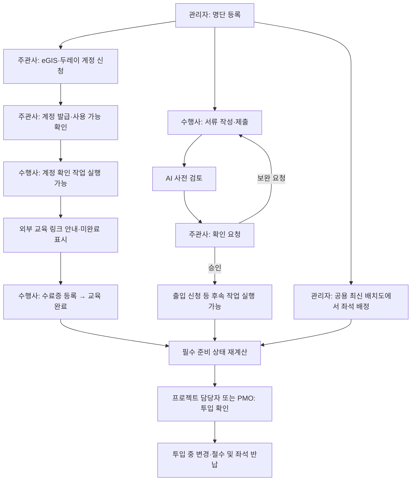

# PMO 수행사 인력 투입관리 서비스 기획안 및 기능 요구사항

> 가칭: **투입ON** — 인원 등록부터 교육·서류·좌석 준비, 투입 중 변경과 철수까지 연결하는 웹서비스
>
> 작성일: 2026-11-09 · 수정일: 2026-11-10 · 문서 버전: 1.3 · 단계: 기획 및 프로토타입 구현 반영
>
> 인턴십 「현업 이슈 해결을 위한 AI 및 디지털 활용 프로젝트」를 위한 기획이다. 본 문서는 구현 완료나 실제 사내 시스템 연동을 의미하지 않는다.
>
> v1.3 변경: 사용자 제공 우리금융그룹 참고 이미지의 블루 팔레트·대각선 모티프·캐릭터를 반영하고 전체 배경을 흰색으로 조정했다. 좌석 일괄 저장과 프로젝트별 권한은 유지한다.
>
> v1.2 변경: Nike 스타일, 좌석 드래그·임시 편집·일괄 저장·취소·충돌 처리, 현재 구현 범위와 운영 전 과제를 반영했다. 실제 동작과 계획의 구분은 18장을 기준으로 한다.
>
> v1.1 변경: 두레이 1:1 API 활용 계획, 수료증 등록형 교육 완료, 역할 간 작업 전환, 프로젝트별 관리 권한, 공용 좌석 최신 버전·이력, 10명 초기 데이터와 19개 예시 작업을 반영했다.

## 1. 기획 요약

### 1.1 해결하려는 문제

프로젝트가 세부 프로젝트로 나뉘어 있고, 각 담당자가 엑셀 등으로 수행사 인원을 관리한다. 전체 명단과 교육·서류·좌석 현황이 통합되지 않아 PMO가 정보를 다시 취합해야 한다. 투입 절차와 담당자 안내도 분산되어 수행사 인원은 같은 질문을 반복하고, 담당자는 같은 내용을 다시 안내한다. 인원 변동이 생겨도 관련 정보가 함께 갱신되지 않는다.

**핵심 문제 정의: PMO가 수행사 인력의 최신 투입 현황과 준비 상태를 한곳에서 확인할 수 없어, 취합·누락 확인·반복 안내에 업무가 집중된다.**

서비스는 인원별로 ‘무엇을 해야 하는지, 누가 처리하는지, 무엇이 남았는지’를 연결한다. AI는 안내, 작성 지원, 누락 검토와 현황 분석을 돕는다.

### 1.2 서비스의 범위

PMO 업무 중 **수행사 인력의 투입 준비와 투입 현황 관리**에 집중한다. 일정은 인력 투입 관련 기한, 문서는 인력 관련 제출 서류, 문의는 투입 관련 작업에 한정한다. 이 범위 안에서 등록 → 준비 → 확인 → 투입 → 변경·철수의 흐름을 완성한다.

| 포함 범위                                      | 이번 범위에서 제외                                       |
| ---------------------------------------------- | -------------------------------------------------------- |
| 수행사·세부 프로젝트별 인원 명단과 투입 이력   | 급여, 근태, 휴가, 인사평가, 채용                         |
| 인원별 준비 작업, 교육, 제출 서류, 담당자 문의 | 프로젝트 전체 일정·산출물·이슈·의사결정 관리             |
| 좌석 배정과 이동·반납                          | 시설 전체 자산·장비·구매 관리                            |
| 투입일·소속 프로젝트 변경, 철수 처리           | 인건비 정산, 계약·구매·회계 처리                         |
| 업무별 AI 지원과 조건부 두레이 연동            | 사내 SSO, 교육 플랫폼 자체 개발, 법적 전자서명 체계 구축 |

### 1.3 핵심 사용자 가치

- **PMO:** 엑셀을 재취합하는 대신, 같은 화면에서 전체 현황과 조치가 필요한 인원을 확인한다.
- **주관사 업무 담당자:** 자신에게 배정된 검토·처리 요청을 받고, 같은 질문에 반복 답하는 시간을 줄인다.
- **수행사 개별 인원:** 본인이 해야 할 작업과 주관사가 처리할 작업을 구분하고, 필요한 교육·서류·문의 경로를 찾는다.

## 2. 확정 요구와 기획 가정

### 2.1 사용자 답변으로 확정된 사항

1. 관리자가 제공된 엑셀 템플릿으로 수행사 인원을 등록한다.
2. 수행사 개별 인원이 본인 교육과 서류를 처리한다. 수행사 담당자의 일괄 등록을 기본 흐름으로 두지 않는다.
3. 관리자와 수행사 화면을 제공하고, 상단 버튼으로 시연 중 화면을 전환한다.
4. 사내 로그인 연동은 제외하되, 현업 도입을 고려해 기획한다.
5. 사용자 확인에 따라 두레이 메신저 1:1 메시지 전송 API를 향후 연동 경로로 사용한다. 이번 기획 수정에서 실제 전송은 수행하지 않는다.
6. AI를 안내·서류 작성·검토 등 여러 업무에 배치하고, 업무별 에이전트로 구성한다.
7. 교육은 외부 사이트 링크로 안내하고, 수료증 등록 전에는 미완료, 정상 파일 등록 후에는 완료로 표시한다.
8. 선행 작업이 완료되면 다른 역할의 후속 작업을 실행 가능으로 전환한다. 서류는 AI 사전 검토 후 주관사에 확인 요청한다.
9. 시연 프로젝트는 SFA·그룹웨어이며 각 5명, 총 10명이다. 표시명은 SFA-1~SFA-5, GW-1~GW-5이고 담당자는 SFA-담당자·GW-담당자다.
10. 좌석 배정은 관리자 화면에서만 수행하고, 모든 주관사 관리자가 같은 최신 배치도와 버전 이력을 본다.
11. 주관사 화면의 시연용 드롭다운은 PMO·SFA·그룹웨어로 구성한다. 프로젝트 담당자는 본인 프로젝트만 관리하고 PMO는 전체를 조회·관리한다.
12. 좌석 변경은 임시 편집에 모으고 변경 저장 버튼을 누를 때만 공용 원장에 반영하며 새 버전 하나를 생성한다. 저장 전에는 취소할 수 있다.
13. 현재 화면은 사용자가 제공한 우리금융그룹 참고 이미지의 블루 팔레트·숫자 1의 대각선 모티프·캐릭터를 활용하며, 전체 페이지 배경은 흰색으로 유지한다.

### 2.2 기획을 완성하기 위해 적용한 기본안

| 항목      | 기본안                                                                                      | 실제 도입 전 확정할 내용                         |
| --------- | ------------------------------------------------------------------------------------------- | ------------------------------------------------ |
| 교육      | 외부 사이트 링크 → 수료증 발급 → 서비스 등록으로 교육 완료 표시, 증빙 검증 상태는 별도 관리 | 실제 교육 URL, 인정 기준, 유효기간               |
| 제출 서류 | PDF와 이미지 제출, PDF 미리보기·읽기 항목 안내를 우선 지원한다                              | 실제 서식, 필수 항목, 보관기간, 허용 형식        |
| 서명      | 사용자가 서명한 문서를 제출하고 담당자가 확인한다                                           | 사내에서 인정하는 서명 방식·전자서명 연동 필요성 |
| 인원 식별 | 내부 인원 ID와 투입 건 ID를 사용한다                                                        | 기존 사번·외부인 식별번호와의 매핑               |
| 계정      | 시연은 가상 계정, 실사용은 SSO 없는 초대 기반 개별 인증을 적용한다                          | 사내에서 허용하는 인증·초대 방식                 |
| 좌석      | 공용 배치도·사용 기간·최신 버전·변경 이력 관리, 배정은 관리자만 가능                        | 실제 배치도, 좌석 정책, 관리 담당자              |
| 시간      | 업무 기한과 화면 표시는 한국시간을 기본으로 한다                                            | 사내 업무일·휴일 및 마감 시각                    |
| AI        | 승인된 안내 자료와 접근 허용된 업무 데이터만 사용한다                                       | 모델 제공사, 사내 이용·데이터 반출 기준, 비용    |

이 기본안으로 화면과 업무 흐름을 설계할 수 있다. 실제 연동·운영에 필요한 확인 사항은 16장에 정리한다.

## 3. 현재 업무와 개선 방식

| 현재 업무의 문제                      | 서비스에서의 처리                       | 개선 여부를 확인할 방법    |
| ------------------------------------- | --------------------------------------- | -------------------------- |
| 담당자별 엑셀을 받아 명단을 재취합    | 관리자 엑셀 등록과 검증, 통합 명단 제공 | 명단 취합 소요시간 비교    |
| 교육·서류 진행 상태를 따로 확인       | 인원별 준비 현황과 미완료 작업을 연결   | 누락 확인·재문의 횟수 비교 |
| 수행사 인원이 절차·담당자를 반복 문의 | 작업별 설명·AI 안내·담당자 문의 제공    | 유형별 반복 문의 건수 비교 |
| 이동·철수가 좌석에 반영되지 않음      | 투입 건 변경과 좌석 사용 기간을 연결    | 명단·좌석 불일치 건수 비교 |
| 서류 보완 이유를 메신저에서 재안내    | 문서 버전별 검토 의견과 보완 이력 관리  | 반려·보완 왕복 횟수 비교   |

효과는 아직 측정되지 않았다. 제시한 개선은 검증할 가설이며, 절감률을 실적처럼 제시하지 않는다.

## 4. 사용자·권한과 시연 모드

### 4.1 사용자 역할과 프로젝트 권한

주관사 화면은 PMO와 두 프로젝트 담당자가 같은 메뉴·레이아웃을 사용한다. 사람·서류·작업의 조회 및 처리 범위만 달라진다. 좌석 배치도는 공간의 공용 현황이므로 모든 주관사 관리자에게 동일한 최신 버전을 제공한다.

| 역할·시연 계정   | 인원·작업 조회 및 관리                      | 좌석 배치도                | 좌석 변경 권한                      |
| ---------------- | ------------------------------------------- | -------------------------- | ----------------------------------- |
| PMO              | SFA·그룹웨어 전체, 공통 기준·담당자 설정    | 전체 최신 배치도·버전 이력 | 전체 프로젝트 배정·이동·해제        |
| SFA-담당자       | SFA-1~SFA-5의 등록·작업·서류 검토·투입 처리 | 전체 최신 배치도·버전 이력 | SFA 소속 인원만 배정·이동·해제      |
| GW-담당자        | GW-1~GW-5의 등록·작업·서류 검토·투입 처리   | 전체 최신 배치도·버전 이력 | 그룹웨어 소속 인원만 배정·이동·해제 |
| 수행사 개별 인원 | 본인 정보·작업·자료·문의만                  | 본인 좌석 위치·기간만      | 배정·이동·해제 불가, 요청만 가능    |

다른 프로젝트가 점유한 좌석을 프로젝트 담당자가 직접 비우거나 변경할 수 없다. 전체 배치도에는 좌석 번호·사용 여부·프로젝트·최소 인원 표시명만 공유하고, 다른 프로젝트 인원의 상세 프로필·연락처·서류로 이동할 수 없게 한다. 민감 서류 원문은 PMO에게도 별도 열람 권한을 적용한다. 서버 API·엑셀 등록·내보내기·AI 조회에도 같은 프로젝트 범위를 적용한다.

### 4.2 상단 역할 전환과 주관사 드롭다운

- 상단 화면 전환은 `[주관사(관리자)] [수행사]`로 제공한다.
- 주관사 선택 시 `[PMO ▼]` 드롭다운의 옵션을 **PMO / SFA / 그룹웨어**로 고정한다. 이는 시연 시점의 사용자 맥락을 바꾸는 기능이다.
- PMO 선택 시 전체 프로젝트, SFA 선택 시 SFA-담당자·SFA 5명, 그룹웨어 선택 시 GW-담당자·GW 5명의 업무를 표시한다.
- 수행사 선택 시 `[SFA-1 ▼]` 선택기에 SFA-1~SFA-5, GW-1~GW-5를 제공한다. 실제 서비스에서는 본인 계정으로 고정한다.
- 역할을 바꿔도 같은 서버 데이터를 사용한다. 담당자 작업 완료 → 수행사 실행 가능, 수행사 제출 → AI 검토 → 담당자 확인 요청이 연결된다.
- 시연 모드·가상 데이터임을 표시하고 초기화 기능을 제공한다. 초기 명단·상태·좌석 버전은 17장을 기준으로 한다.
- 실사용에서는 드롭다운으로 계정 권한을 바꿀 수 없다. 로그인 권한에 맞는 범위만 서버가 허용하고 시연용 전환을 제거한다.

## 5. 핵심 업무 흐름



### 5.1 기본 상호작용

1. SFA-담당자가 SFA-3의 eGIS·두레이 계정 사용 가능 확인을 완료한다.
2. SFA-3의 ‘계정 최초 접속·본인 정보 확인’이 선행 작업 대기에서 **실행 가능**으로 바뀐다. 새 알림과 시작 버튼이 나타난다.
3. SFA-3이 접속 확인을 완료하면 연결된 교육 작업이 실행 가능해진다. 교육 사이트 링크는 제공되지만 수료증이 없으면 **미완료**다.
4. 교육 사이트에서 수강하고 발급받은 수료증을 등록하면 교육 카드는 **완료 · 수료증 등록됨**으로 바뀐다. 증빙 검증 상태는 별도로 표시한다.
5. 서류를 제출하면 수행사 화면에는 **AI 검토 중**이 나타난다. AI가 누락·서명·필수 항목을 사전 검토한 후 SFA-담당자 화면에 **확인 요청**이 생성된다.
6. 담당자는 AI 결과와 원문을 보고 승인하거나 보완 요청한다. 보완 요청은 수행사 작업에 즉시 반영되고 재제출 시 새 버전으로 다시 검토한다.
7. 승인이 필요한 후속 작업은 담당자 승인 이후에만 실행 가능해진다. AI 검토 완료만으로 선행조건을 충족시키지 않는다.

### 5.2 예시 업무 템플릿

다음은 두 프로젝트에 공통 적용할 가상 업무다. 실제 사내 절차를 확인한 결과가 아니며, 기획·시연을 위해 구성했다. `O`는 투입 준비 작업, `X`는 철수 작업이다. 초기 10명은 모두 상주 인원으로 가정한다.

| 작업 ID | 예시 업무                             | 수행 주체 | 선행조건                                     | 완료 또는 전달 기준                                       |
| ------- | ------------------------------------- | --------- | -------------------------------------------- | --------------------------------------------------------- |
| O01     | 명단 등록·프로젝트 및 투입 기간 확인  | 주관사    | 없음                                         | 엑셀 검증·등록 확정                                       |
| O02     | eGIS 사용자 계정 신청                 | 주관사    | O01                                          | 신청 접수 정보 기록                                       |
| O03     | eGIS 발급·권한 사용 가능 확인         | 주관사    | O02                                          | 발급 결과·계정 안내 제공, 비밀번호는 저장하지 않음        |
| O04     | 두레이 사용자 계정 신청               | 주관사    | O01                                          | 신청 접수 정보 기록                                       |
| O05     | 두레이 발급·사용 가능 확인            | 주관사    | O04                                          | 발급 결과와 접속 안내 제공                                |
| O06     | 계정 최초 접속·본인 정보 확인         | 수행사    | O03·O05 모두 완료                            | 본인이 접속 결과 확인, 문제 시 담당자 문의                |
| O07     | 프로젝트 온보딩 안내 확인             | 수행사    | O06                                          | 지정 안내·문의 경로 확인 기록                             |
| O08     | 정보보안 교육 수강·수료증 등록        | 수행사    | O06                                          | 유효 형식 수료증 파일 등록 시 교육 완료                   |
| O09     | 개인정보보호 교육 수강·수료증 등록    | 수행사    | O06                                          | 유효 형식 수료증 파일 등록 시 교육 완료                   |
| O10     | 보안서약서 작성·서명·제출             | 수행사    | O01                                          | 제출 → AI 검토 → 담당자 확인 요청                         |
| O11     | 개인정보 수집·이용 동의서 제출        | 수행사    | O01                                          | 제출 → AI 검토 → 담당자 확인 요청                         |
| O12     | 제출 서류 확인·보완 또는 승인         | 주관사    | O10·O11 제출본의 AI 검토 종료 또는 수동 전환 | 각 서류 최종 승인 시 완료                                 |
| O13     | 출입 신청·이용 가능 확인              | 주관사    | O12 승인 완료                                | 신청 및 이용 가능 결과 기록                               |
| O14     | 좌석 배정·위치 안내                   | 주관사    | O01                                          | 공용 좌석 원장에 기간 배정 확정                           |
| O15     | 출입·업무 공간 이용 안내 확인         | 수행사    | O06·O13 완료                                 | 본인이 안내 확인 기록                                     |
| O16     | 최종 투입 준비 확인·투입 확정         | 주관사    | O07·O08·O09·O12·O13·O14·O15 완료             | 필수조건 재검사, 투입일과 담당자 확인에 따라 투입 중 전환 |
| X01     | 철수 예정일·반납 대상 확인            | 주관사    | 철수 절차 개시                               | 종료일·담당자 확정                                        |
| X02     | 좌석·출입 관련 반납 완료 보고         | 수행사    | X01                                          | 본인 반납 보고·필요 증빙 제출                             |
| X03     | 계정 정리·좌석 반납 확인 및 철수 종료 | 주관사    | X02                                          | 외부 계정 정리 확인, 좌석 배정 종료, 철수 확정            |

계정 신청·발급은 eGIS·두레이 시스템을 자동 조작하는 기능이 아니라 주관사가 외부 처리한 결과를 이 서비스에 기록하는 업무다. 두레이 1:1 메시지 API 연동과 계정 생성 API 연동은 서로 다른 범위다. O10·O11은 계정 발급을 기다리지 않고 병행할 수 있다. O12는 서류별 확인 요청을 먼저 받고, 두 서류가 모두 승인되면 완료된다. 이미 완료된 서류를 다른 서류 보완 때문에 초기화하지 않는다.

### 5.3 변경·철수 시나리오

수행사가 변경을 요청하면 해당 프로젝트 담당자 또는 PMO가 적용일·영향을 확인한다. 철수 작업은 투입 준비 진행률과 별도로 생성한다. X02 보고만으로 좌석을 비우지 않고, 주관사의 X03 확인을 임시 반영하고, 좌석 관리에서 변경 저장을 눌렀을 때 철수와 좌석 반납을 함께 확정하며 새 버전 하나를 발행한다. 과거 투입·문서·배정 이력은 보존한다.

## 6. 화면 구성

### 6.1 공통 레이아웃

상단은 서비스명, 알림, 시연용 화면 전환과 주관사 맥락 드롭다운(PMO / SFA / 그룹웨어)으로 구성한다. 왼쪽은 업무 메뉴, 중앙은 목록·상세, 오른쪽은 현재 화면을 이해하는 AI 지원 패널로 구성한다. 작은 화면에서는 AI 패널을 접거나 별도 패널로 연다. AI 패널을 닫아도 모든 핵심 업무를 처리할 수 있어야 한다.

### 6.2 관리자 화면

| 화면             | 주요 내용                                                                | 핵심 행동                                                          |
| ---------------- | ------------------------------------------------------------------------ | ------------------------------------------------------------------ |
| 전체 현황        | 투입 예정·투입 중·철수 예정 인원, 준비 미완료, 기한 초과, 오늘 검토 대상 | 필터 적용, 해당 인원·작업으로 이동                                 |
| 인원 명단        | 수행사·세부 프로젝트·상태·투입 기간·교육·서류·좌석 현황                  | 템플릿 다운로드, 엑셀 등록, 검색·필터, 엑셀 내보내기               |
| 인원 상세        | 기본 정보, 투입 이력, 전체 작업, 교육, 서류, 좌석, 문의, 변경 이력       | 작업 처리, 담당자 배정, 투입·변경·철수 확인                        |
| 준비 작업 관리   | 수행사/주관사 작업, 기한, 담당자, 지연 사유                              | 조건별 작업 템플릿 설정, 작업 재배정                               |
| 교육·서류 검토함 | AI 검토 중, 확인 요청, 보완 요청, 재제출, AI 검토 의견                   | 확인 요청 확인, 원문 검토, 승인·보완 요청                          |
| 좌석 관리        | 모든 관리자 공용 최신 배치도, 배정 기간, 사용 불가 좌석, 우측 버전 이력  | 권한 내 인원 클릭·드래그 편집, 변경 내역·취소·일괄 저장, 버전 비교 |
| 문의·알림        | 작업별 문의, 담당자, 답변 상태, 전송 결과                                | 답변, 담당자 변경, 알림 초안 확인·발송                             |
| 운영 기준        | 수행사·프로젝트·역할, 교육·서류·작업 템플릿, 담당자 매핑                 | 기준 등록·버전 관리, 연동 상태 확인                                |

주관사 드롭다운은 명단·검토함·업무 집계의 프로젝트 범위에 적용한다. 단, 좌석 관리 메뉴는 프로젝트별 복제 화면이 아니라 전체 공용 배치도를 유지하며, 선택한 역할에 따라 편집 가능한 인원만 제한한다. 같은 조회일·기간에는 모든 관리자가 같은 저장본을 본다. 미저장 편집은 해당 탭·역할에서만 표시하며 공용 최신 원장과 구분한다.

전체 현황에서 숫자를 누르면 같은 기준의 목록으로 이동해야 한다. 예를 들어 ‘3일 내 투입 예정·서류 미완료’ 카드는 해당 조건의 인원만 보여준다.

관리자 인원 상세의 상단에는 `투입일 / 준비 상태 / 미완료 필수 작업 / 담당자`를 고정한다. 진행률이 높아도 필수 작업이 남으면 이유와 조치 버튼을 보여준다.

### 6.3 수행사 화면

| 화면           | 주요 내용                                                   | 핵심 행동                                |
| -------------- | ----------------------------------------------------------- | ---------------------------------------- |
| 나의 투입 준비 | 프로젝트·투입 기간, 준비 상태, 먼저 할 일, 주관사 처리 현황 | 다음 작업 시작, 문의                     |
| 나의 작업      | 수행사 수행/주관사 수행 구분, 필수 여부, 기한, 선행조건     | 내 작업 처리, 주관사 작업 상태 확인      |
| 교육           | 필수 교육 사이트 링크, 미완료/완료, 수료증, 증빙 검증 상태  | 교육 사이트 열기, 수료증 등록·교체       |
| 서류           | 양식, 작성 안내, 읽기·서명 필요 위치, 제출·검토 이력        | 다운로드, 미리보기, 제출·재제출, AI 질문 |
| 내 좌석        | 배정 위치·사용 기간, 미배정 상태                            | 위치 확인, 이동 요청                     |
| 문의·변경 요청 | 작업별 문의, 답변, 투입 기간 등 변경 요청                   | 문의·요청 작성, 결과 확인                |

```text
[투입ON] [알림] [주관사(관리자) | 수행사]
주관사: [PMO / SFA / 그룹웨어 ▼]   수행사: [SFA-1~5 / GW-1~5 ▼]
나의 투입 준비               현재 선택 인원: SFA-3 · 시연 모드
투입 예정일 / 준비 상태 / 다음 필수 작업

[내가 할 작업] [주관사가 처리할 작업]
계정확인  실행 가능                [시작하기] [문의]
교육      미완료 · 선행 작업 대기   [교육 안내] [문의]
보안서약  보완 요청: 서명 누락     [서류 열기] [문의]
출입신청  주관사 검토 중          [상태 보기] [문의]
좌석      배정 완료               [위치 보기]

문서 작업 영역                       AI 작성 도우미
PDF·양식 미리보기                    이 문서의 작성 안내
읽기/서명 위치로 이동                 근거 페이지·항목 표시
파일 제출 및 검토 이력                질문 / 담당자에게 문의
```

## 7. 기능 요구사항

우선순위는 **P0: 완결된 1차 서비스**, **P1: 현업 적용 확대**, **P2: 후속 확장**이다. P1을 생략한 상태를 최종 현업 도입 완료로 표현하지 않는다. 외부 연동은 별도의 검증 조건을 가진다.

### 7.1 명단 등록·관리

| ID     | 우선순위 | 요구사항                                                      | 완료 기준                                                                  |
| ------ | -------- | ------------------------------------------------------------- | -------------------------------------------------------------------------- |
| PER-01 | P0       | 관리자에게 버전이 표시된 XLSX 템플릿과 작성 예시를 제공한다   | 필수 열·입력 형식·코드값 설명이 포함된다                                   |
| PER-02 | P0       | 업로드 시 필수값, 날짜, 프로젝트·수행사 코드, 중복을 검사한다 | 오류의 행·열·원인과 수정 방법을 표시하고 오류 파일을 내려받는다            |
| PER-03 | P0       | 등록 전 신규·변경·중복 후보를 미리 보여준다                   | 업로드만으로 기존 데이터가 변경되지 않는다                                 |
| PER-04 | P0       | 전체 파일 검증이 끝난 후 관리자가 등록을 확정한다             | 오류가 남으면 반영하지 않으며, 같은 업로드 재확정으로 중복 생성하지 않는다 |
| PER-05 | P0       | 회사·프로젝트·역할·투입 기간·상태별 검색과 필터를 제공한다    | 필터 결과와 내보내기 결과가 같은 권한·조건을 따른다                        |
| PER-06 | P0       | 한 사람의 재투입·복수 프로젝트 투입을 이력으로 관리한다       | 사람과 투입 건을 구분하고 프로젝트별 진행 상태를 보존한다                  |
| PER-07 | P1       | 변경 파일 업로드 시 차이와 처리 중 충돌을 표시한다            | 기존 승인 상태·첨부파일을 명단 갱신만으로 덮어쓰지 않는다                  |
| PER-08 | P0       | 변경 요청과 관리자 수정의 적용일·사유·처리자를 기록한다       | 수행사가 요청만으로 소속·투입 기간을 직접 확정할 수 없다                   |

**등록 템플릿 기본 열:** 작업 유형(신규/변경), 기존 인원 ID·투입 건 ID(변경 시), 성명, 회사 코드, 업무용 이메일, 세부 프로젝트 코드, 역할 코드, 투입 시작일·종료일, 상주 여부, 주관사 담당자 코드. 두레이 사용자 식별자는 연동 시 선택 열로 둔다.

시스템은 신규 인원 ID를 생성하고, 이후 내보낸 명단에 ID를 포함한다. 성명만으로 인원을 병합하지 않는다. 같은 이메일 등 중복 후보도 관리자가 기존 인물 여부를 확인한다. 내보내기 시 엑셀 수식으로 해석될 수 있는 값을 안전하게 처리한다.

### 7.2 준비 작업·담당자 관리

| ID     | 우선순위 | 요구사항                                                                               | 완료 기준                                                                          |
| ------ | -------- | -------------------------------------------------------------------------------------- | ---------------------------------------------------------------------------------- |
| TSK-01 | P0       | 작업 템플릿에 수행 주체, 처리 담당자, 안내, 필수 여부, 기한 규칙, 완료 조건을 설정한다 | 수행사/주관사 작업을 화면에서 구분한다                                             |
| TSK-02 | P0       | 프로젝트·역할·상주 여부에 따라 작업을 생성한다                                         | 비대상 교육·서류·좌석은 미완료가 아닌 비대상으로 표시한다                          |
| TSK-03 | P0       | 작업 간 선행조건과 투입일 기준 상대 기한을 관리한다                                    | 선행 미완료 시 시작 불가 이유를 표시하며, 투입일 변경 시 기한 변화를 미리 보여준다 |
| TSK-04 | P0       | 모든 작업에 문의 버튼과 담당자 정보를 제공한다                                         | 담당자 미지정 시 PMO 공통 문의함으로 연결한다                                      |
| TSK-05 | P0       | 교육 완료와 서류 승인을 구분한다                                                       | 교육은 수료증 등록으로 완료, 서류는 AI 검토 후 담당자 승인 시 완료된다             |
| TSK-06 | P1       | 대리 처리·예외 승인 시 사유와 근거를 남긴다                                            | 예외 승인 항목과 적용 기한을 확인할 수 있고 일반 완료와 구분한다                   |
| TSK-07 | P0       | 템플릿의 버전과 인원별 적용 결과를 보관한다                                            | 템플릿 변경이 기존 완료 작업을 예고 없이 초기화하지 않는다                         |
| TSK-08 | P0       | 선행 작업 완료 시 연결된 후속 작업을 실행 가능으로 갱신한다                            | 양쪽 화면에 같은 결과를 표시하고 서버가 실행 가능 여부를 검증한다                  |
| TSK-09 | P0       | 제출·AI 검토·확인 요청·보완·승인에 따라 역할별 할 일을 연결한다                        | 제출본 버전별 검토 요청이 정확한 프로젝트 담당자에게 한 번 생성된다                |
| TSK-10 | P0       | 차단 사유와 필요한 선행 작업·담당자를 표시한다                                         | 선행조건을 우회한 직접 API 요청도 실행을 거부한다                                  |

주관사 작업 예시는 계정 발급 요청 확인, 출입 신청 확인, 좌석 배정이다. 본 서비스는 처리 현황을 관리하며, 외부 시스템의 계정 발급·출입 권한 설정을 실제로 수행한 것으로 간주하지 않는다.

### 7.3 교육 관리

| ID     | 우선순위 | 요구사항                                                          | 완료 기준                                                                                         |
| ------ | -------- | ----------------------------------------------------------------- | ------------------------------------------------------------------------------------------------- |
| EDU-01 | P0       | 교육별 대상, 링크·자료, 안내, 기한, 수료 기준을 등록한다          | 인원별 적용 교육과 준비 상태에 반영된다                                                           |
| EDU-02 | P0       | 외부 교육 수료 후 발급받은 수료증을 등록하면 교육 완료로 표시한다 | 실제 파일 저장·형식 검증 성공 전에는 미완료이며 링크 열람만으로 완료되지 않는다                   |
| EDU-03 | P0       | 교육 완료와 증빙 검증 상태를 분리하고 보완·교체 이력을 제공한다   | AI 검토 후 담당자 확인 요청을 만들며, 잘못된 증빙이 확인되면 사유와 함께 교육을 미완료로 되돌린다 |
| EDU-04 | P1       | 재수강·교육 개정·유효기간 만료를 관리한다                         | 인정 범위가 맞지 않으면 과거 이수를 자동 재사용하지 않는다                                        |
| EDU-05 | P2       | LMS API로 수료 결과를 동기화한다                                  | 본인 매핑·데이터 기준 시각·오류·수동 보정 이력이 표시된다                                         |

교육 사이트에서 수강과 수료증 발급을 수행한다. 이 서비스는 링크와 수료증 등록을 제공하며 교육 콘텐츠·시험·수료증 발급 기능은 만들지 않는다. **미완료 → 수료증 등록 성공 → 완료**가 사용자 흐름이다. ‘완료’의 근거를 ‘수료증 등록’이라고 표시하고 증빙 검증 중인 것을 승인 완료로 표현하지 않는다.

수료증에도 AI 사전 검토 → 담당자 확인 요청을 적용하되, 확인 대기만으로 교육 완료 표시를 보류하지 않는다. AI는 성명·교육명·날짜 불일치 가능성을 제안한다. 잘못된 파일·다른 교육 수료증으로 담당자가 판정하면 교육을 미완료로 되돌리고 준비 상태와 후속 작업을 재계산한다. 실제 수료 진위 확인은 별도 정책이며 AI가 수료 사실을 인증하지 않는다.

### 7.4 서류 작성·제출·검토

| ID     | 우선순위 | 요구사항                                                                      | 완료 기준                                                                         |
| ------ | -------- | ----------------------------------------------------------------------------- | --------------------------------------------------------------------------------- |
| DOC-01 | P0       | 서류 유형별 양식 버전, 대상, 필수 필드, 읽기·서명 위치를 등록한다             | 관리자가 확정한 위치와 안내가 사용자에게 표시된다                                 |
| DOC-02 | P0       | PDF·이미지 미리보기와 해당 페이지 이동을 제공한다                             | 중요 항목을 선택하면 해당 페이지·영역으로 이동한다                                |
| DOC-03 | P0       | 문서 옆 AI 패널에서 작성 방법을 질문할 수 있다                                | 현재 문서·버전의 근거를 제시하며, 미확인 내용을 단정하지 않는다                   |
| DOC-04 | P0       | 파일 제출·재제출과 원본 버전을 보관한다                                       | 과거 제출본·검토 의견이 최신 파일로 사라지지 않는다                               |
| DOC-05 | P0       | 제출본의 필수 필드·서명 누락 가능성을 AI가 사전 검토한 후 담당자에게 전달한다 | 수행사에는 AI 검토 중 → 담당자 확인 중, 관리자에는 확인 요청과 AI 결과가 표시된다 |
| DOC-06 | P0       | 해당 프로젝트 담당자 또는 PMO가 확인 요청을 받아 승인·보완 요청한다           | 보완 사유·제출본 버전·AI 결과가 연결되고 승인 시 후속 작업이 해제된다             |
| DOC-07 | P1       | 지원 서식의 입력란에 본인 정보와 AI 작성 초안을 채운다                        | 사용자가 확인·수정한 후 저장하며 성명·날짜 등을 추정해 확정하지 않는다            |
| DOC-08 | P1       | 스캔 PDF·이미지의 문자와 위치를 추출한다                                      | 판독 곤란을 표시하고 잘못된 영역을 담당자가 수정한다                              |

**서명·읽기 표시 원칙:** AI는 관리자의 서식 등록 단계에서 필수 위치를 제안하고, 관리자가 검증한 위치를 사용자에게 보여준다. 임의 서류에서 AI가 발견한 위치는 ‘추정 위치’로 표시한다. 중요 내용을 실제로 이해했는지는 화면 열람만으로 증명하지 않는다. 서명 흔적 감지는 서명 진위·본인 의사 확인이 아니며, AI가 서명을 생성·대필하거나 승인하지 않는다. 법적 효력이 필요한 전자서명은 별도 검증된 시스템과의 연동 대상으로 둔다.

1차 지원은 PDF와 이미지다. HWP·DOCX 원문 편집과 모든 임의 양식 자동 이해는 후속 범위로 둔다. 초기에는 표준 서식의 텍스트 PDF와 관리자가 지정한 읽기·서명 위치를 사용해 기능을 완성한다.

### 7.5 좌석 관리

| ID     | 우선순위 | 요구사항                                                                   | 완료 기준                                                                                |
| ------ | -------- | -------------------------------------------------------------------------- | ---------------------------------------------------------------------------------------- |
| SEA-01 | P0       | 모든 주관사 관리자가 공용 좌석 배치도와 기간별 현황을 조회한다             | PMO·SFA·그룹웨어가 동일 공간의 같은 최신 버전을 본다                                     |
| SEA-02 | P0       | 관리자 화면에서 권한 내 인원의 좌석과 기간을 배정한다                      | 수행사 배정 API는 거부하고, 다른 프로젝트 배정 수정과 기간 중복을 차단한다               |
| SEA-03 | P0       | 선택 기간의 공석과 인원별 배정 상태를 제공한다                             | 미래 예약과 현재 사용을 구분한다                                                         |
| SEA-04 | P1       | 좌석 이동·기간 연장·반납 요청을 처리한다                                   | 이전 이력을 보존하고 기간 충돌을 재검사한다                                              |
| SEA-05 | P0       | 비상주·좌석 불필요 인원을 비대상 처리한다                                  | 비대상 인원이 좌석 미배정으로 준비 미완료가 되지 않는다                                  |
| SEA-06 | P0       | 철수 시 좌석 반납 확인과 배정 종료를 연결한다                              | 철수 예정일 도래만으로 실제 반납을 확정하지 않는다                                       |
| SEA-07 | P0       | 여러 좌석 변경을 모아 변경 저장 버튼을 누를 때만 공용 버전 하나를 생성한다 | 드래그·배정·해제마다 버전이 늘어나지 않고, 저장 시 전체 변경 내역·처리자·시각을 기록한다 |
| SEA-08 | P0       | 다른 관리자 저장을 전달하고 오래된 기준 버전의 저장을 차단한다             | 충돌 시 임시 편집을 유지하며 저장을 막고, 취소 후 최신 원장 재편집을 지원한다            |
| SEA-09 | P0       | 배정된 인원을 빈 좌석으로 드래그해 임시 이동한다                           | 원래 사용 기간을 유지하고, 타 프로젝트·점유 좌석·과거 버전 이동을 막는다                 |
| SEA-10 | P0       | 저장 전 변경 내역과 변경 취소를 제공한다                                   | 취소는 임시 편집만 버리고 기존 저장본·버전 이력을 보존한다                               |
| SEA-11 | P0       | 변경이 없는 저장과 원위치 복귀를 처리한다                                  | 순변경이 없으면 저장 버튼을 비활성화하고 버전을 생성하지 않는다                          |

좌석 예약은 날짜 단위로 시작하며 시작일·종료일을 모두 사용일로 본다. 같은 날 교대 사용은 초기 범위에서 제외한다. 한 사람이 같은 기간 여러 프로젝트에 참여해도 물리적으로 같은 근무지에서 좌석을 중복 점유하지 않도록 검사한다. 배치도 전문 편집기는 후속 기능이다.

**공용 최신 상태와 버전 이력:** 좌석 원장은 프로젝트별로 복제하지 않는다. 배정·이동·해제·기간 변경은 임시 편집이며, 변경 저장을 누르기 전에는 공용 원장·인원 준비 상태·이력에 반영하지 않는다. 저장 성공 시 전체 공용 버전(v1, v2…)을 증가시키고 변경 내용과 이력을 한 트랜잭션으로 기록한다. 운영 설계에서는 SSE 또는 WebSocket으로 다른 관리자 화면에 저장 이벤트를 전달하고 재연결·탭 복귀 시 최신 버전을 다시 조회한다. 초기 목표는 정상 연결에서 저장 후 3초 이내 동기화이며 실제 검증 결과를 별도로 기록한다.

화면에는 저장본의 `최신 v4`와 미저장 변경 수·기준 버전을 구분해 표시한다. 현재 프로토타입은 localStorage의 저장본과 탭 간 이벤트를 사용하며 운영용 실시간 서버는 아직 구현하지 않았다. 운영 도입 시 마지막 동기화 시각과 연결 상태도 표시한다. 연결이 끊기면 ‘최신 상태 확인 불가’ 표시와 함께 수정 확정을 막는다. 저장 시 클라이언트 기준 버전과 서버 버전이 다르면 충돌 안내 후 최신 데이터를 불러온다. ‘항상 최신’은 오래된 데이터를 최신이라고 표시하지 않고 저장 직전에도 검증한다는 요구다.

오른쪽 버전 패널은 좌석 변경자·시각·사유·전후 차이를 제공한다. 과거 버전 조회에는 ‘과거 버전·읽기 전용’을 명시하고 현재 배치를 변경하지 않는다. 초기에는 과거 버전의 일괄 복원은 제공하지 않는다. 새 배정·이동·기간 변경·반납은 저장 전 편집에 모으며, 변경 저장 한 번에 버전 하나를 생성한다. 빈 저장은 새 버전을 만들지 않는다. 과거 버전 열람은 미저장 변경을 버리지 않으며 최신 화면 복귀 시 복원한다.

### 7.6 문의·알림·변경 및 철수

| ID     | 우선순위 | 요구사항                                            | 완료 기준                                                           |
| ------ | -------- | --------------------------------------------------- | ------------------------------------------------------------------- |
| COM-01 | P0       | 작업별 문의에 인원·프로젝트·작업·담당자를 연결한다  | 사용자가 같은 맥락을 다시 입력하지 않아도 되며 발송 내용을 확인한다 |
| COM-02 | P0       | 앱 안에서 문의·답변·처리 상태를 관리한다            | 두레이 미연동 상태에서도 전체 문의 흐름을 사용할 수 있다            |
| COM-03 | P0       | 제출·보완 요청·승인·기한 알림을 앱 안에서 제공한다  | 변경된 작업으로 바로 이동하고 읽음 여부를 관리한다                  |
| COM-04 | P1       | 두레이 메신저 1:1 메시지 전송 API 어댑터를 연결한다 | 프로젝트 담당자와 수신자 ID 매핑, 실제 응답·실패·재시도를 검증한다  |
| COM-05 | P1       | 전송 재시도·중복 방지·발송 이력을 관리한다          | 타임아웃을 성공으로 표시하지 않고 같은 이벤트의 중복 발송을 막는다  |
| LIF-01 | P0       | 투입일·종료일·프로젝트 변경을 검토·적용한다         | 적용 전 관련 기한·좌석·작업의 영향을 확인한다                       |
| LIF-02 | P0       | 철수 확인 작업과 좌석 반납을 관리한다               | 미완료 필수 철수 작업이 있으면 정상 철수 완료로 바꾸지 않는다       |
| LIF-03 | P1       | 재투입 시 과거 유효 증빙의 재사용을 제안한다        | 유효기간·프로젝트 인정 범위를 담당자가 확인한다                     |

문의 초안은 AI가 작성할 수 있지만 사용자 확인 후 전송한다. 자동 기한 알림은 관리자가 사전에 정한 대상·조건·빈도에 따라 발송하며, 사용자 문의와 구분한다.

## 8. 상태와 업무 규칙

### 8.1 상태를 분리해 관리한다

| 대상               | 상태                                                                                     |
| ------------------ | ---------------------------------------------------------------------------------------- |
| 투입 건의 생애주기 | 투입 예정 → 투입 중 → 철수 예정 → 철수 완료 / 투입 취소                                  |
| 준비 상태          | 준비 미완료 / 준비 충족 / 재확인 필요                                                    |
| 일반 작업          | 선행 작업 대기 / 실행 가능 / 진행 중 / 확인 요청 / 보완 요청 / 완료 / 비대상             |
| 교육               | 미완료 / 완료(수료증 등록) / 비대상, 증빙 검증 상태는 별도                               |
| 서류·증빙 검토     | 미제출 / AI 검토 대기 / AI 검토 중 / 확인 요청 / 보완 요청 / 승인 / 재확인 필요 / 비대상 |
| 문의               | 접수 / 담당자 확인 중 / 답변 완료 / 종료                                                 |
| 메시지 전달        | 미전송 / 전송 중 / API 접수 / 실패 / 결과 확인 필요                                      |

기한 초과는 별도의 표시로 계산하며 보완 요청 등의 상태를 대체하지 않는다. AI 검토 실패도 서류 업무 상태와 분리한다. 승인된 자료는 중요 정보·유효성·규정이 바뀔 때 재확인 대상으로 전환하고 기존 승인 이력은 보존한다.

### 8.2 역할 간 작업 전환 규칙

- 선행조건이 모두 충족되면 실행 가능으로 바꾼다. 여러 선행조건은 기본적으로 AND이며, 각 미완료 작업과 담당자를 표시한다. 순환 의존성은 템플릿 저장 시 거부한다.
- 주관사 완료 이벤트와 후속 실행 가능 전환·앱 알림을 연결한다. 알림 전송이 실패해도 완료된 업무를 되돌리지 않는다.
- 서류 제출은 파일 저장 후 AI 분석 작업을 생성한다. 관리자 검토함에는 분석 중 항목을 볼 수 있지만, 정상 흐름의 확인 요청은 AI 결과가 준비된 뒤 생성한다.
- AI 검토에서 이상을 발견해도 자동 승인·반려하지 않는다. 누락 의심·판단 불가를 포함해 담당자에게 확인 요청한다.
- AI 오류·지연에는 ‘분석 실패·수동 확인 필요’를 표시한다. 담당자가 수동 검토로 전환하면 AI 결과 없음 표시와 함께 확인 요청을 처리한다. 제출본은 사라지지 않는다.
- 새 제출본이 생기면 이전 제출본 분석·승인 요청은 최신 요청을 덮어쓰지 않는다. 완료된 이전 AI 작업이 늦게 돌아와도 현재 상태를 바꾸지 않는다.
- 선행 완료가 취소되면 시작 전 후속 작업은 다시 대기시킨다. 이미 처리된 작업은 이력을 보존하고 재확인 필요로 표시하며 투입 준비를 다시 검사한다.
- 화면 업데이트는 서버 상태를 기준으로 전달한다. 실시간 연결이 복구되면 재조회하며 역할 전환 시에도 최신 상태를 읽는다.

### 8.3 준비 상태 계산

- 해당 투입 건의 필수 교육이 수료증 등록으로 완료되었고, 증빙 부적합 판정이나 만료가 없다. 확인 대기는 별도로 표시한다.
- 필수 서류의 현재 요구 버전에 대한 인정 조건을 충족한다.
- 필수 주관사 준비 작업이 완료되었다.
- 좌석 필요 인원은 해당 투입 기간에 맞는 좌석이 배정되었다.
- 선행조건과 미해결 차단 사항이 없다.

위 조건을 시스템 규칙으로 계산한다. AI가 준비 완료 여부를 결정하지 않는다. 조건 충족은 ‘준비 충족’이며, 실제 투입 중 전환은 투입 시작일과 해당 프로젝트 담당자 또는 PMO의 O16 확인을 함께 적용한다. 날짜가 지났다는 이유만으로 준비 미완료 인원을 투입 완료로 표시하지 않는다.

O12는 서류의 주관사 검토를 묶는 항목이므로 원본 서류와 중복 집계하지 않는다. O16은 준비 조건을 확인하는 최종 행동이므로 준비율의 분모·분자와 자신의 선행조건 계산에서 제외한다. 명단 등록 O01도 관리상 생성 단계이므로 준비율에서 제외하고, O02~O15의 적용 가능한 실제 준비 작업을 기준으로 계산한다. 철수 작업도 준비율에 넣지 않는다. 준비율은 `완료 또는 승인된 필수 항목 수 ÷ 적용되는 필수 항목 수`로 표시하고, 교육·서류·일반 작업이 같은 항목을 중복 집계하지 않도록 한다. 선택 항목은 별도로 표시한다. 적용 항목이 0개이면 100% 대신 ‘기준 미설정’으로 표시하고 투입 확정을 막는다. 비대상 처리에는 근거를 남긴다. 예외 승인은 허용된 항목만 사유·승인자·만료일을 기록하며 정해진 범위에서 조건 충족으로 인정한다.

투입 중 교육 만료나 서류 재확인이 발생하면 ‘투입 중’ 이력은 유지하고 ‘재확인 필요’ 경고와 보완 작업을 생성한다. 시스템이 임의로 인원을 철수시키지 않는다.

### 8.4 변경의 영향

- 투입일 변경: 상대 기한을 재계산하고 이미 완료된 작업의 증빙은 보존한다.
- 프로젝트·역할 변경: 신규 필수 작업만 추가하고 기존 자료의 인정 가능 여부를 다시 판단한다.
- 서류 양식 변경: 자동 전원 재제출 대신 시행일·적용 대상·기존 승인 인정 정책을 설정한다.
- 투입 취소: 아직 시작하지 않은 작업과 미래 좌석 예약을 정리하고 사유를 보존한다.
- 철수 완료: 후속 알림을 중단하고 사용자 접근 범위와 보관 정책을 적용한다.

## 9. 업무별 AI 에이전트

### 9.1 구성 원칙

사용자에게는 현재 화면에 맞는 하나의 AI 패널을 제공한다. 내부에서는 질문·작업 유형을 구분해 필요한 에이전트를 호출한다. 인원·투입 건·작업·문서 버전을 공유하되, 각 호출 시 서버에서 조회 권한을 다시 적용한다. 에이전트마다 별도 모델이나 독립 서비스를 운영할 필요는 없으며, 역할별 지침·도구·평가 기준을 분리한다.

| 에이전트               | 배치 화면           | 사용 근거·도구                             | 주요 결과                                             | 우선순위                |
| ---------------------- | ------------------- | ------------------------------------------ | ----------------------------------------------------- | ----------------------- |
| 투입 안내 에이전트     | 나의 준비·작업      | 승인된 안내·FAQ, 본인 작업 조회            | 다음 할 일, 순서·기한 설명, 담당자 연결               | P0                      |
| 서류 작성 에이전트     | 서류 상세           | 해당 서식·작성 지침·관리자 확정 위치       | 항목별 작성 안내, 읽기·서명 위치 설명, 지원 서식 초안 | 안내 P0, 초안 채우기 P1 |
| 증빙 검토 에이전트     | 제출 결과·검토함    | 필수항목 규칙, 해당 제출본의 추출 결과     | 누락 의심 항목·근거 위치·판단 불가 사유               | P0                      |
| PMO 현황 분석 에이전트 | 전체 현황·인원 상세 | 권한 적용된 DB 조회, 상태 계산 결과        | 지연 인원, 원인별 분류, 조치 제안, 보고 초안          | P0                      |
| 문의·안내 에이전트     | 문의·알림           | 작업 담당자 매핑, 업무 맥락, 허용된 템플릿 | 담당자 추천, 문의·보완 요청·독촉 초안                 | P0, 외부 전달 P1        |

좌석 중복 판정, 상태 전이, 필수값 검사, 기한 계산은 일반 프로그램 규칙으로 처리한다. 좌석 배정 최적화나 별도의 좌석 AI는 초기 범위에 넣지 않는다.

### 9.2 대표 상호작용

**수행사:** “이 보안서약서에서 어디에 사인해야 하나요?”

AI는 현재 서식의 관리자 확정 메타데이터를 읽고 해당 페이지의 서명란을 강조한다. 작성 지침과 서식 버전을 표시한다. 스캔 품질이 낮거나 서식이 다르면 위치를 확정하지 않고 담당자 확인을 안내한다.

**수행사:** “왜 아직 준비 미완료인가요?”

AI는 서버가 계산한 미완료 항목을 읽어 “정보보안 교육은 수료증이 등록되어 완료되었지만, 보안서약서는 담당자 확인 요청 상태이고 좌석 배정은 주관사 처리 중입니다”라고 설명한다. 직접 처리할 항목과 기다릴 항목을 나누고 관련 화면으로 연결한다.

**관리자:** “다음 주 투입 예정자 중 확인이 필요한 사람과 조치 순서를 알려줘.”

AI는 한국시간 기준 다음 주의 날짜 범위를 먼저 표시하고, 데이터 기준 시각과 검색 조건을 제시한다. 서버 조회 결과를 바탕으로 투입 임박·필수 미완료·검토 지연을 분류한다. 인원 수와 상태는 DB 결과를 사용하며 모델이 숫자를 만들어내지 않는다.

### 9.3 AI 결과의 계약과 통제

- 안내 답변에는 근거 자료명·버전·페이지 또는 작업 링크를 제시한다. 근거가 부족하면 확인 필요로 답한다.
- 검토 결과에는 항목, 판정(확인/누락 의심/판단 불가), 근거 페이지·영역, 사유, 제안 조치를 포함한다. 검증되지 않은 확률을 정확도처럼 표시하지 않는다.
- 집계 답변은 사용한 필터·기준 시각·근거 목록을 포함한다. 조회 실패 시 이전 결과를 최신 결과로 제시하지 않는다.
- AI의 제안과 사람이 확정한 값을 구분한다. 승인·반려·서명·인원 변경·좌석 확정·외부 메시지 전송을 AI 단독으로 수행하지 않는다.
- 문서에 포함된 명령문은 분석할 내용으로만 취급하고 권한·시스템 지침을 변경하는 명령으로 실행하지 않는다.
- AI 실패·지연 시 기본 업무는 계속 사용할 수 있다. 규칙 검사와 담당자 수동 검토로 전환하고 ‘AI 분석 완료’로 표시하지 않는다.
- 현재 문서·인원을 바꾸면 AI 맥락도 바꾼다. 이전 사용자의 서류·대화가 다음 사용자에게 노출되지 않아야 한다.
- 실제 인원·문서를 외부 AI로 보내는 기능은 사내 허용 범위를 확인한 후 활성화한다. 시연은 가상 데이터로 진행한다.

### 9.4 AI 검증 계획

정상 작성본, 필수값 누락본, 서명 누락본, 판독 곤란본, 개정 서식, 근거 없는 질문, 권한 밖 인원 질문을 포함한 고정 평가 자료를 만든다. 필수항목 검출의 정밀도·재현율, 근거 일치율, 답변 보류의 적절성, 사용자 수정률, 응답 지연·호출 비용을 기록한다. 특히 ‘누락인데 정상으로 안내한 사례’를 별도로 검토한다. 모델·지침·서식 변경 후 같은 자료로 재평가한다.

## 10. 두레이 연동 계획

### 10.1 선택한 연동 경로

사용자가 두레이 메신저 **1:1 메시지 전송 API가 있다**고 확인했으므로, 향후 서버 측 API 어댑터로 연동한다. MCP 확보를 선행조건으로 삼지 않는다. 공식 문서·엔드포인트·인증·사내 허용 범위는 아직 검증하지 않았으며, 이번 문서 수정에서 API 호출이나 실제 메시지 전송은 하지 않는다.

초기 시연은 앱 내 알림·문의와 ‘두레이 미연동’ 상태로 진행한다. 외부 전송을 흉내 낸 화면을 실제 전달 성공으로 표시하지 않는다.

### 10.2 사용할 메시지

| 이벤트                 | 기본 수신자                 | 기본 내용                                                       |
| ---------------------- | --------------------------- | --------------------------------------------------------------- |
| 수행사의 작업 문의     | 해당 프로젝트의 작업 담당자 | 프로젝트·최소 인원 식별정보·작업명·확인한 문의 내용·서비스 링크 |
| 주관사 선행 작업 완료  | 해당 수행사 인원            | 새로 실행 가능한 작업과 서비스 링크                             |
| AI 검토 종료·확인 요청 | SFA-담당자 또는 GW-담당자   | 검토 대상·확인 요청·권한이 적용되는 서비스 링크                 |
| 보완 요청·승인         | 해당 수행사 인원            | 결과 요약·다음 작업·서비스 링크                                 |
| 기한 알림              | 사전 설정된 담당자·수행사   | 미완료 작업·기한·서비스 링크                                    |

업무별 담당자가 아직 설정되지 않았으면 해당 프로젝트 담당자로 연결하고, 매핑 오류면 PMO 문의함에 표시한다. AI는 초안을 만들고 사용자가 확인해 문의를 보낸다. 시스템 알림은 관리자가 사전에 승인한 규칙을 따른다. 계정 비밀번호·서명 이미지·문서 원문은 메시지에 넣지 않는다.

### 10.3 향후 연동 검증

1. 공식 API 문서와 인증·발신 주체·수신자 식별 방식·권한·제한을 확인한다. 비밀값은 설정에서 보관하고 문서·클라이언트 코드에 넣지 않는다.
2. SFA-담당자·GW-담당자 및 10명 가상 인물의 두레이 ID 매핑 구조를 만든다. 가상 ID로 실제 사람에게 전송하지 않는다.
3. 별도 승인된 테스트 계정으로 1:1 전송과 실제 수신을 검증한다. 이번 기획 요청은 전송 권한을 뜻하지 않는다.
4. 문의·업무 이벤트·중복 방지 키와 API 결과를 연결하고 실패·타임아웃·재시도를 시험한다.
5. API 접수, 실제 수신 확인, 읽음, 담당자 업무 완료를 구분한다. 1:1 전송 API의 존재만으로 답변 수신·읽음·대화 동기화 기능을 가정하지 않는다.
6. 미연동·실패 시 앱 내 업무와 문의를 유지한다. 수신 API가 없다면 답변 이력의 기준은 앱 내 문의함이다.

## 11. 데이터 구조와 시스템 구성안

### 11.1 주요 데이터

| 개체                | 핵심 정보·관계                                                                      |
| ------------------- | ----------------------------------------------------------------------------------- |
| 사용자·권한         | 로그인 식별자, 역할, 접근 가능 프로젝트, 개인 인원 매핑                             |
| 인원                | 내부 인원 ID, 성명, 업무용 연락처, 소속 이력                                        |
| 수행사·프로젝트     | 회사·세부 프로젝트 코드, 주관사 담당자                                              |
| 투입 건             | 인원, 수행사, 프로젝트, 역할, 상주 여부, 기간, 생애주기                             |
| 작업 템플릿·작업    | 적용 조건·버전, 수행 주체, 담당자, 기한, 필수·선행조건, 실행 가능 상태, 완료 이벤트 |
| 교육·이수 증빙      | 교육 URL·버전·유효성, 수료증 등록 기준 완료 상태, 별도 증빙 검증 상태·제출 버전     |
| 서류 서식·제출본    | 서식 버전, 필수 필드·읽기·서명 영역, 파일 버전, 검토 이력                           |
| 좌석·배정           | 전체 공용 건물·층·구역, 사용 상태, 인원·프로젝트·투입 건, 사용 기간                 |
| 좌석 배치도 버전    | 전역 버전, 기준 버전, 변경자·시각·사유, 좌석 전후 차이, 읽기 전용 과거 상태         |
| 문의·메시지         | 관련 작업, 작성자, 담당자, 답변 상태, 외부 전달 상태·참조 ID                        |
| 변경 요청·감사 이력 | 대상, 변경 전후, 적용일, 사유, 요청자·처리자                                        |
| AI 실행 기록        | 실행 유형, 입력 자료 버전·권한 범위, 근거, 결과, 모델·지침 버전, 사용자 채택 여부   |

교육은 수료증 등록 결과, 서류는 담당자 승인 결과를 연결된 작업 상태의 근거로 사용한다. 서로 독립된 중복 상태를 만들어 한쪽만 갱신하지 않는다. 준비 상태는 원본 상태를 기반으로 재계산하며, 화면에 데이터 갱신 시각을 보여준다.

### 11.2 권장 구성

```text
웹 화면: 관리자 / 수행사 / 공통 AI 패널
                   ↓ 인증·권한 검사
업무 서버: 명단·작업·교육·서류·좌석·문의·변경 규칙
      ├─ 관계형 DB: 인원·상태·권한·이력
      ├─ 비공개 파일 저장소: 서식·제출본·증빙
      ├─ 비동기 작업: 파일 분석·알림·외부 전송·재시도
      ├─ AI 실행부: 역할별 에이전트·허용 도구·근거 검색
      └─ 외부 어댑터: 두레이 / 향후 LMS·전자서명
```

개인 과제에서는 하나의 웹 애플리케이션과 업무 서버로 시작한다. 예시 기술 조합은 Next.js·TypeScript, PostgreSQL, 비공개 파일 저장소, 서버 측 LLM 호출이다. 에이전트 분리를 이유로 마이크로서비스를 늘리지 않는다. 기술 선택은 사내 배포 환경과 AI 이용 정책을 확인한 뒤 확정한다.

## 12. 개인정보·운영 품질 요구사항

| 구분      | 요구사항·검증 기준                                                                                                                                     |
| --------- | ------------------------------------------------------------------------------------------------------------------------------------------------------ |
| 접근 통제 | 모든 조회·다운로드·변경 API에 프로젝트·본인·문서 권한을 적용한다. URL·ID를 바꿔 다른 인원의 정보를 조회할 수 없어야 한다                               |
| 개별 인증 | 시연 전환과 실사용 인증을 분리한다. SSO를 제외해도 운영 시 개별 인증·세션 만료·접근 회수는 구현한다                                                    |
| 최소 수집 | 주민등록번호 등 불필요한 민감정보는 수집하지 않는다. 연락처·문서 항목도 실제 업무 필요성을 확인한다                                                    |
| 파일 보호 | 형식·크기·내용 유형을 검사하고 운영 시 악성 파일 검사를 적용한다. 공개 저장 링크를 사용하지 않고 권한 검사 후 제한 시간 링크를 제공한다                |
| 외부 전송 | AI·메신저로 보낼 항목을 제한한다. 첨부 원문·서명 이미지·비밀정보는 기본 알림에 넣지 않는다                                                             |
| 감사 이력 | 인원 변경, 문서 열람·다운로드, 승인, 대리 처리, 외부 전송, 권한 변경의 행위자·시각·대상을 기록한다                                                     |
| 보관·삭제 | 인원·문서·AI 기록·백업의 보관기간과 삭제 책임자를 정한다. 철수와 즉시 삭제를 동일하게 취급하지 않는다                                                  |
| 동시 수정 | 두 관리자의 동시 승인·좌석 배정·엑셀 갱신 충돌을 서버에서 감지한다. 확정 직전 조건을 다시 검사한다                                                     |
| 장애 복구 | 파일 처리 실패·AI 장애·메신저 장애를 분리 표시한다. 재시도해도 중복 제출·전송이 생기지 않게 한다                                                       |
| 사용성    | 색상 외 텍스트·아이콘으로 상태를 구분하고 키보드·포커스·파일 처리 진행 상태를 제공한다                                                                 |
| 성능      | 가상 인원 500명·동시 사용자 10명을 초기 부하 시험 조건으로 제안한다. 주요 목록 95백분위 2초 이내를 목표로 측정한다. 실사용 규모와 결과에 따라 조정한다 |

위 부하와 시간은 제안한 검증 조건이며 검증된 성능이 아니다. AI·파일 분석은 비동기 처리하며 처리 중·실패·재시도 상태를 표시한다.

## 13. 구현 단계와 완료 범위

### 13.1 1차: 업무가 끝까지 연결되는 P0 서비스

- 주관사·수행사 화면, PMO/SFA/그룹웨어 드롭다운과 SFA·그룹웨어 각 5명 가상 데이터.
- 엑셀 검증·명단 등록, 인원 상세, 조건별 작업 생성.
- 교육 링크·증빙, PDF·이미지 제출·검토·보완, 표준 서식의 읽기·서명 위치 표시.
- 관리자 전용 공용 좌석 배치도, 기간 배정·중복 검사·최신 상태 동기화·버전 패널, 기본 투입 변경·철수.
- 선행 작업 해제·AI 검토·확인 요청의 역할 간 상호작용, 앱 내 문의·알림, 미완료 항목 중심 대시보드.
- 다섯 AI 역할의 제한된 범위 구현: 안내·작성 지침·누락 의견·현황 요약·문의 초안.
- 권한 검사, 파일 접근 통제, 변경 이력. AI·외부 연동이 없어도 기본 업무 처리 가능.

### 13.2 2차: 현업 적용을 위한 P1 기능

- SSO 없는 개별 초대·인증·권한 회수의 운영 검증.
- 두레이 메신저 1:1 전송 API의 실제 문의 전달·알림과 실패 처리.
- 스캔 문서 OCR, 지원 서식 초안 채우기, 교육 만료·재인정, 명단 변경 일괄 반영.
- 좌석 이동 요청, 예외 승인, 철수 후 재투입 인정 절차.
- 실제 규정·서식·담당자·보관 정책 적용, 보안·운영 검토.

1차 결과물은 완결된 시연 서비스이며, 2차의 운영 전제조건까지 검증해야 실제 현업 적용을 주장할 수 있다. 두레이 연동이 막히면 원인과 미완료 범위를 명시한다. 다른 업무의 완성도를 낮춰 모든 확장 기능을 동시에 구현하지 않는다.

### 13.3 후속 확장 P2

LMS 자동 동기화, 검증된 전자서명 연동, 복잡한 문서 편집, 전문 좌석 배치도 편집, 다른 프로젝트로의 템플릿 재사용을 검토한다. 과제 기간·예산·개발 가능 시간이 제시되지 않았으므로 고정 주차별 일정을 약속하지 않고 위 단계의 완료 기준으로 진행을 관리한다.

## 14. 수용 기준과 시연 시나리오

### 14.1 핵심 수용 기준

| 검증 항목                | 기대 결과                                                                                |
| ------------------------ | ---------------------------------------------------------------------------------------- |
| 오류가 있는 명단 업로드  | 잘못된 행·열이 표시되고 전체 등록 전 데이터가 변경되지 않는다                            |
| 같은 명단의 중복 확정    | 동일 인원·투입 건·작업이 중복 생성되지 않는다                                            |
| 비상주 인원 등록         | 좌석은 비대상이며 미배정 때문에 준비 미완료가 되지 않는다                                |
| 교육 링크만 열기         | 교육 미완료가 유지된다                                                                   |
| 교육 수료증 등록         | 파일 저장·검증 성공 후 교육 완료·수료증 등록됨으로 바뀌고 증빙 검증은 별도 표시된다      |
| 수행사 서류 제출         | AI 검토 중 → 해당 프로젝트 관리자 확인 요청으로 연결되고 제출본·AI 결과가 함께 나타난다  |
| 주관사 계정 발급 확인    | 연결된 수행사 계정 확인 작업이 실행 가능해지고 실제 시작할 수 있다                       |
| AI 실패 후 수동 전환     | AI 결과 없음이 표시된 확인 요청으로 처리 가능하며 자동 승인은 하지 않는다                |
| 프로젝트 권한            | SFA 담당자는 GW 인원 상세·서류·수정 API에 접근할 수 없고 PMO는 전체 현황을 본다          |
| 공용 좌석 배치도 갱신    | 저장 전에는 다른 역할·탭에 변경이 보이지 않고, 변경 저장 후 모두 같은 버전을 본다        |
| 여러 좌석 연속 이동      | 편집 중에는 버전 수가 유지되고 저장 한 번에 새 버전 하나만 추가된다                      |
| 미저장 변경 취소         | 임시 배정·이동·반납만 취소되고 저장본과 이전 이력은 유지된다                             |
| 원위치 복귀              | 순변경이 없으면 저장을 비활성화하고 버전을 만들지 않는다                                 |
| 오래된 좌석 버전 저장    | 충돌을 알리고 최신 원장 재조회 후 재확정하도록 하며 다른 관리자의 변경을 덮어쓰지 않는다 |
| 수행사 좌석 변경 시도    | UI에 배정 기능이 없고 직접 변경 API 호출도 거부된다                                      |
| 보완 요청·재제출         | 사유가 본인에게 보이고 이전 파일·검토 이력이 보존된다                                    |
| 필수 서류가 빠진 상태    | 진행률과 관계없이 준비 충족·투입 확정을 할 수 없다                                       |
| 서명 누락·판독 곤란      | AI가 누락 의심·판단 불가를 표시하며 자동 승인하지 않는다                                 |
| 좌석 동시·기간 중복 배정 | 서버가 충돌을 차단하고 실패 이유를 표시한다                                              |
| 권한 밖 인원·문서 요청   | API·다운로드·AI 답변 모두 접근을 거부한다                                                |
| 두레이 장애·미매핑       | 문의는 앱에 보존되고 외부 전송 성공으로 표시하지 않는다                                  |
| AI 서비스 중단           | 파일 제출·담당자 검토·명단·좌석 업무를 계속 처리할 수 있다                               |
| 변경·철수                | 관련 기한·작업·좌석이 일관되게 갱신되고 이력이 남는다                                    |

### 14.2 과제 발표용 시연

1. **문제 제시:** 담당자별 엑셀에 흩어진 명단·교육·서류 정보를 가상 자료로 보여준다.
2. **관리자 등록:** 오류가 있는 엑셀을 올리고 수정한 뒤 등록한다. 조건에 맞는 작업이 생성되는 것을 확인한다.
3. **역할 간 해제:** SFA-담당자가 SFA-4의 계정 발급을 확인하고 수행사로 전환해 계정 확인 작업이 실행 가능해지는 것을 보여준다.
4. **교육·AI 작성 지원:** SFA-3의 수료증 등록으로 교육이 완료되는 것을 보여준다. 서약서 작성 지원 후 SFA-2의 제출본 AI 검토와 담당자 확인 요청을 확인한다.
5. **검토 왕복:** 관리자가 보완을 요청하고, 수행사가 재제출한 뒤 관리자가 승인한다. 양쪽 화면의 같은 상태를 확인한다.
6. **공용 좌석·권한:** SFA 담당자가 본인 인원을 배정·드래그 이동한 뒤 저장 전에는 다른 역할에 보이지 않음을 확인한다. 여러 변경을 한 번 저장한 후 GW·PMO로 바꿔 새 버전 하나와 반영 결과를 확인한다. 변경 취소와 다른 탭의 선행 저장으로 인한 충돌도 시연한다. 다른 프로젝트 인원 수정·수행사 좌석 배정은 차단된다. 두레이는 향후 API 검증 후에만 실제 전송을 시연한다.
7. **PMO 판단:** AI에 투입 임박 미완료 인원을 질문하고, 근거 목록과 조치 초안을 확인한다. 준비가 충족된 인원을 해당 프로젝트 담당자 또는 PMO가 투입 확정한다.
8. **생애주기 완결:** 종료일 변경과 철수 작업·좌석 반납을 보여준다.

시연의 중심은 기능 수가 아니라 **한 인원의 준비와 확인이 두 화면에서 연결되고 PMO의 재취합·재안내를 줄일 수 있는가**다. 실제 연동·AI 결과·가상 응답은 명확히 구분한다.

## 15. 성과 측정과 과제 보고서 구성

### 15.1 성과지표

| 지표               | 측정 정의                                           | 검증 방법                                     |
| ------------------ | --------------------------------------------------- | --------------------------------------------- |
| 명단 취합 소요시간 | 같은 범위의 인원을 통합·오류 확인하는 데 걸린 시간  | 기존 엑셀 방식과 서비스 방식의 작업 시간 비교 |
| 반복 문의          | 절차·교육·서류·담당자 관련 동일 유형 문의 건수      | 일정 기간·투입 인원당 문의를 유형별 집계      |
| 준비 누락          | 예정 투입 시점에 필수 항목이 미충족인 투입 건 비율  | 같은 필수 기준을 적용해 비교                  |
| 서류 보완 왕복     | 서류 유형별 최초 제출부터 승인까지 보완 횟수        | 문서 유형·복잡도를 맞춰 비교                  |
| 현황 정확성        | 표본 점검 시 명단·실제 상태·좌석 기록의 불일치 건수 | 담당자 확인 기준과 서비스 기록 대조           |
| AI 도움의 품질     | 근거 일치, 누락 탐지, 초안 수정률, 처리 시간·비용   | 고정 평가 자료와 사용자 과업 시험             |

실제 현업 자료 사용이 어렵다면 동일한 가상 데이터와 동일 업무를 사용해 비교한다. 참여자의 숙련도·두 번째 수행의 학습효과를 기록하고, 소규모 시연 결과를 조직 전체 효과로 확대하지 않는다. 절감률 목표는 현재 업무의 기준값을 측정한 후 정한다.

### 15.2 발표의 설명 흐름

현업에서 발견한 분산 관리·반복 문의 문제 → 인원별 업무 흐름으로 좁힌 이유 → 통합 데이터와 규칙으로 해결한 부분 → AI가 안내·작성·검토를 도운 부분 → 시연·평가 결과 → 실제 도입을 위한 연동·보안 조건 순으로 설명한다. 규칙 기반 기능과 AI 기능을 구분해 AI를 사용한 이유를 보여준다.

## 16. 실제 도입 전 확인할 사항

아래 항목은 기획 문서의 미완성 부분이 아니라 실제 연동·운영의 선행조건이다. 기본 흐름은 2장의 가정으로 설계하고, 확인 결과에 따라 설정·연동 범위를 조정한다.

| 확인 대상            | 필요한 정보                                               | 미확인 시 적용 방식                                        |
| -------------------- | --------------------------------------------------------- | ---------------------------------------------------------- |
| PMO·각 업무 담당자   | 실제 작업 목록, 책임 주체, 필수 여부, 완료 조건, 기한     | 가상 표준 템플릿 사용, 현업 승인 전 실사용 차단            |
| 교육 담당자          | 실제 교육 URL·수료증·재인정·만료 기준                     | 예시 링크·가상 수료증 등록과 별도 증빙 확인, LMS 연동 제외 |
| 서류 담당자          | 실제 양식·작성 지침·필수 읽기·서명 위치                   | 가상 PDF 서식과 관리자 지정 위치로 시연                    |
| 두레이 운영 담당자   | 1:1 전송 API 문서·인증·수신자 ID·사내 권한·응답 수신 범위 | 앱 내 문의·알림, 실제 전송 미실행                          |
| 보안·개인정보 담당자 | 인증, 파일 저장, AI 반출, 보관·삭제·감사 기준             | 가상 데이터만 사용, 운영 전환 보류                         |
| 좌석 담당자          | 좌석 기준정보, 기간·이동·반납 정책                        | 가상 구역·좌석 사용                                        |
| 과제 운영 조건       | 제출일, 개인 개발 가능 시간, 인프라·AI 예산               | P0 우선, P1을 별도 검증 단계로 관리                        |

## 17. 임시 데이터 및 시연 초기 상태

### 17.1 프로젝트와 관리자

아래 값은 전부 가상 데이터다. 현재 프로토타입의 초기 데이터로 구현했으며, 초기화 기능의 기준으로 사용한다. 운영 DB나 실제 교육 수료 기록은 아니다. 각 초기 상태는 가상 증빙·시연용 AI 결과와 함께 구성한다.

| 구분       | 프로젝트 표시명 | 프로젝트 코드 | 담당자 표시명 | 수행사 표시명         | 인원 수 |
| ---------- | --------------- | ------------- | ------------- | --------------------- | ------- |
| 전체 관리  | 전체            | 전체 범위     | PMO           | 전체                  | 10명    |
| 프로젝트 1 | SFA             | SFA           | SFA-담당자    | SFA 수행사(가상)      | 5명     |
| 프로젝트 2 | 그룹웨어        | GW            | GW-담당자     | 그룹웨어 수행사(가상) | 5명     |

주관사 드롭다운의 `그룹웨어`와 내부 코드 `GW`는 같은 프로젝트다. 두 가상 수행사의 회사명은 추후 교체할 수 있다. 관리자 계정은 PMO·SFA-담당자·GW-담당자이며, 수행사 개인 계정과 구분한다.

### 17.2 인원 명단과 대표 시연 상태

시연 기준 시각은 **2026-11-09 14:00 한국시간**으로 가정한다. 아래 업무용 이메일은 발송하지 않는 `.example` 가상 주소다. 두레이 실제 사용자 ID는 넣지 않고 `미매핑`으로 둔다. 모든 인원은 상주·좌석 필요로 설정한다.

| 인원 표시명 | 프로젝트 | 업무용 이메일      | 투입 시작일 | 초기 생애주기 | 대표 상태·다음 행동                                  | 초기 좌석 |
| ----------- | -------- | ------------------ | ----------- | ------------- | ---------------------------------------------------- | --------- |
| SFA-1       | SFA      | sfa-1@demo.example | 2026-11-09  | 투입 중       | 필수 준비·투입 확인 완료, 정상 현황 확인             | A-01      |
| SFA-2       | SFA      | sfa-2@demo.example | 2026-11-16  | 투입 예정     | 서류 AI 검토 중 → SFA-담당자 확인 요청               | 미배정    |
| SFA-3       | SFA      | sfa-3@demo.example | 2026-11-16  | 투입 예정     | 계정 확인 완료, 교육 미완료·수료증 등록 시연         | 미배정    |
| SFA-4       | SFA      | sfa-4@demo.example | 2026-11-16  | 투입 예정     | eGIS·두레이 발급 대기, 주관사 완료 후 계정 확인 해제 | 미배정    |
| SFA-5       | SFA      | sfa-5@demo.example | 2026-11-16  | 투입 예정     | 신규 등록, 계정 신청부터 시작                        | 미배정    |
| GW-1        | 그룹웨어 | gw-1@demo.example  | 2026-11-09  | 투입 중       | 필수 준비·투입 확인 완료, 정상 현황 확인             | B-01      |
| GW-2        | 그룹웨어 | gw-2@demo.example  | 2026-11-16  | 투입 예정     | 서명 누락 의심 결과가 포함된 담당자 확인 요청        | 미배정    |
| GW-3        | 그룹웨어 | gw-3@demo.example  | 2026-11-16  | 투입 예정     | AI 분석 실패, 담당자 수동 확인 전환 시연             | 미배정    |
| GW-4        | 그룹웨어 | gw-4@demo.example  | 2026-11-16  | 투입 예정     | eGIS 발급 완료·두레이 발급 대기, AND 선행조건 시연   | 미배정    |
| GW-5        | 그룹웨어 | gw-5@demo.example  | 2026-11-10  | 투입 예정     | 준비 충족, 투입일 도래 후 담당자 투입 확정 시연      | B-02      |

투입 종료일은 전원 2027-02-26으로 가정한다. 실제 날짜가 바뀌는 시연에서는 기준일 대비 상대 일자로 함께 이동시켜 의도치 않은 기한 초과가 발생하지 않도록 한다. 준비율과 대시보드 수치는 아래 작업·문서·증빙 상태로 계산하고 화면마다 별도 숫자를 하드코딩하지 않는다.

### 17.3 작업·증빙 초기 상태

표에 없는 작업은 무조건 실행 가능으로 두지 않는다. 선행조건이 모두 충족되고 별도 상태가 없으면 실행 가능, 아니면 선행 작업 대기로 계산한다. 모든 명단의 O01은 완료다. 파일이나 승인 이력이 필요한 완료 항목에는 해당 가상 제출·검토 기록도 함께 구성한다.

| 인원  | 추가 완료 작업 | 제출·처리 중 또는 예외 상태                                      | 후속 화면에서 보여줄 내용                                       |
| ----- | -------------- | ---------------------------------------------------------------- | --------------------------------------------------------------- |
| SFA-1 | O02~O16 전체   | 교육 증빙 확인·서류 승인 완료                                    | 준비 충족·투입 중, A-01 안내                                    |
| SFA-2 | O02~O09        | O10·O11 제출, AI 검토 중; 교육 수료증은 등록 완료·증빙 확인 대기 | O12 확인 요청은 AI 결과 이후 생성, O13·O15 대기, O14 실행 가능  |
| SFA-3 | O02~O06        | 교육 수료증·서류 미제출                                          | O07·O08·O09·O10·O11·O14 실행 가능, 교육 미완료                  |
| SFA-4 | O02·O04        | O03·O05 진행 중                                                  | O06 선행 작업 대기, O10·O11·O14는 병행 실행 가능                |
| SFA-5 | 없음           | 추가 신청·증빙 없음                                              | O02·O04·O10·O11·O14 실행 가능, 계정 후속 작업 대기              |
| GW-1  | O02~O16 전체   | 교육 증빙 확인·서류 승인 완료                                    | 준비 충족·투입 중, B-01 안내                                    |
| GW-2  | O02~O09        | O10 서명 누락 의심·O11 필수항목 확인, AI 종료·서류 확인 요청     | O12에서 GW-담당자가 보완 요청 또는 승인, O13·O15 대기           |
| GW-3  | O02~O07        | O10·O11 제출 후 AI 분석 실패, 수료증 미등록                      | 관리자에 수동 확인 필요, O12 수동 전환 가능, O08·O09 미완료     |
| GW-4  | O02·O03·O04    | O05 진행 중                                                      | O06은 두레이 발급을 기다림, O10·O11·O14 병행 가능               |
| GW-5  | O02~O15 전체   | 교육 증빙 확인·서류 승인 완료                                    | 준비 충족, O16은 준비 확인 가능하나 투입일 전 투입 중 전환 금지 |

O10·O11은 제출·검토가 연결된 수행사 작업으로, 문서 승인 시 최종 완료된다. 제출 후에는 AI 검토 중·담당자 확인 중·보완 요청을 표시한다. O12는 같은 서류들의 주관사 확인 작업을 묶는 항목이며, 준비율에서는 원본 서류와 중복 집계하지 않는다. AI 성공·실패 시연은 가상 분석 결과임을 표시하고 실제 모델 실행 기록과 섞지 않는다.

### 17.4 교육·문서·좌석 기본 데이터

| 유형 | 가상 항목                    | 기본 설정                                                    |
| ---- | ---------------------------- | ------------------------------------------------------------ |
| 교육 | 정보보안 교육                | 외부 링크 입력 필드, 대상 전원, 수료증 등록형                |
| 교육 | 개인정보보호 교육            | 외부 링크 입력 필드, 대상 전원, 수료증 등록형                |
| 서류 | 보안서약서 v1                | 성명·회사·프로젝트·날짜·본인 서명, 읽기·서명 위치 메타데이터 |
| 서류 | 개인정보 수집·이용 동의서 v1 | 목적·항목·보유기간·동의 여부·성명·날짜·서명, 중요 읽기 항목  |
| 좌석 | 가상 업무공간 1층 A·B 구역   | A-01~A-06, B-01~B-06, 총 12석                                |

교육 URL은 실제 주소를 아직 제공받지 않았으므로 초기에는 ‘교육 링크 미설정’과 담당자를 표시한다. 구현 시 관리자 설정을 통해 실제 링크로 바꾼다. 시연용 교육 안내 페이지를 사용하는 경우 외부 교육 실연동으로 표현하지 않는다. 가상 수료증에는 `시연용·효력 없음`을 표시하고 실제 사내 교육 수료 사실로 사용하지 않는다.

초기 공용 배치도는 **v4**다. A-01=SFA-1, B-01=GW-1, B-02=GW-5이며 나머지 9석은 공석이다. 좌석을 프로젝트별로 사전 독점하지 않으며 다른 프로젝트도 공석에 본인 인원을 배정할 수 있다. 기존 타 프로젝트 점유 좌석 수정은 PMO만 가능하다.

| 버전 | 가상 변경 시각(한국시간) | 변경자     | 변경 내용·사유                       |
| ---- | ------------------------ | ---------- | ------------------------------------ |
| v1   | 2026-11-09 09:00         | PMO        | 12석 공간 초기 등록                  |
| v2   | 2026-11-09 09:30         | SFA-담당자 | SFA-1에 A-01 배정, 11/09~2027/02/26  |
| v3   | 2026-11-09 10:00         | GW-담당자  | GW-1에 B-01 배정, 11/09~2027/02/26   |
| v4   | 2026-11-09 11:00         | GW-담당자  | GW-5에 B-02 선배정, 11/10~2027/02/26 |

v4는 최신 원장 버전이다. 기준일 11/09의 점유 현황은 2석 사용·1석 미래 예약·9석 미배정이고, 11/10 이후 동일 기간에는 3석 사용·9석 미배정이다. 우측 버전 패널에서 v2를 열면 그 당시 배정 상태만 읽기 전용으로 보인다. 시연 초기화는 10명·업무·파일 기록·알림·좌석 v1~v4를 함께 복원하는 개발 전용 기능이며 실제 운영 이력을 삭제하는 기능으로 제공하지 않는다.

## 18. 현재 프로토타입 구현 현황

### 18.1 문서와 구현의 관계

1~17장의 기능 요구사항은 목표 서비스의 설계다. 요구사항에 P0가 적혀 있다고 해서 서버·연동·AI까지 개발 완료된 것은 아니다. 현재 구현물은 **React·Vite 기반의 브라우저 인터랙티브 프로토타입**이며, 아래 표를 현재 상태의 기준으로 사용한다.

| 기능               | 현재 구현                                                                    | 운영 전 필요한 작업                                                     |
| ------------------ | ---------------------------------------------------------------------------- | ----------------------------------------------------------------------- |
| 관리자·수행사 화면 | 역할·인물 전환, PMO/SFA/그룹웨어 범위별 UI                                   | 실제 인증·서버 권한 검사, 세션·계정 회수                                |
| 명단               | 10명 가상 데이터, XLSX 등록·검증·내보내기, 이름·소속 검색·필터               | 영속 DB, 고유 인원·투입 ID, 변경 파일 병합·충돌 검토                    |
| 등록 템플릿        | 성명·프로젝트·회사·역할·이메일·투입시작일·투입종료일의 7개 열                | 7.1장의 코드·ID·변경 유형을 포함한 운영 템플릿                          |
| 준비 작업          | 공통 O01~O16의 선행조건, 수행 주체별 처리, 준비율                            | 역할별 템플릿 편집·버전 관리, 실제 발급·출입 시스템 연결                |
| 교육               | 교육 URL 설정·안내, 수료증 등록 시 완료, 별도 증빙 검토·보완                 | 실제 교육 URL·이수 정책, 수료 진위·유효기간 검증                        |
| 서류               | PDF·이미지 선택·현재 탭 미리보기, 서식 안내·서명 위치 화면, 제출·보완·승인   | 비공개 원본 저장, 과거 파일 버전·다운로드 감사, 실제 OCR·필수 필드 분석 |
| AI                 | 규칙에 따른 안내·현황 요약, 시연 결과 버튼으로 사전 검토→확인 요청 연결      | 실제 모델·도구·검색·OCR 연결 및 업무별 평가                             |
| 좌석               | 12석 공용 원장, 클릭·드래그 편집, 임시 내역·취소·저장, 저장별 버전·과거 조회 | 서버 트랜잭션·실시간 공유, 실제 공간·좌석 정책                          |
| 좌석 동기화        | 같은 브라우저·출처의 탭 간 localStorage 이벤트로 저장본 반영                 | 다른 사용자·기기 간 SSE/WebSocket·DB 연동                               |
| 문의·알림          | 앱 내 문의·답변·상태 알림                                                    | 두레이 1:1 전송 API, 실패·재시도·수신자 매핑                            |
| 인원 변경·철수     | 투입 기간·역할 직접 변경, 철수 확인 체크리스트·좌석 반납 일괄 저장           | 세부 프로젝트 이동, 요청·승인 분리, 외부 계정 정리 검증                 |

파일명·진행 상태·명단·문의·저장된 좌석과 버전은 이 기기의 localStorage에 보관한다. 실제 파일 데이터의 미리보기는 현재 탭의 메모리에서만 유지하며 새로고침 후 유지되지 않는다. 이전 제출 파일과 전자서명을 보관·인증하는 시스템이 아니다. 현재 권한 제한은 프런트엔드 시연이므로 실제 개인정보·민감 서류를 넣지 않는다.

### 18.2 화면 디자인

현재 디자인은 사용자가 제공한 우리금융그룹 관련 참고 이미지 4장(캐릭터, 디자인 모티프, 색상표, 서체 설명)을 기준으로 한다. 해당 웹사이트를 직접 확인한 것으로 표현하지 않는다.

- **배경과 색상:** 페이지 배경은 흰색이다. 첨부 색상표에 기재된 주조색 `#0067ac`와 보조색 `#253a71`·`#123f6d`·`#00aec6`·`#00afad`를 버튼·제목·정보 강조에 사용한다. 카드와 표에는 연한 블루 구분선과 흰 면을 적용한다.
- **디자인 모티프:** 숫자 1의 형상과 대각선 면을 환영 영역·안내 카드에 적용한다. 큰 영문 캠페인 문구 대신 한국어 업무 제목과 친근한 안내를 사용한다.
- **캐릭터:** 환영 화면에는 그룹 캐릭터를 함께 배치하고, AI 안내에는 파란 캐릭터, 빈 상태에는 보조 캐릭터를 배치한다. 명단·검토·좌석 관리의 핵심 조작 영역을 가리지 않는다. 모바일에서는 진행률과 캐릭터를 위아래로 분리한다.
- **캐릭터 자산의 성격:** 첨부 이미지에서 생성 도구로 정리한 프로토타입용 그래픽을 사용한다. 공식 배포 원본·브랜드 인증·정식 승인 서비스 자산으로 표시하지 않는다.
- **글꼴:** 참고 이미지에 소개된 우리다움체 원본 파일은 제공되지 않아 포함하지 않는다. 한국어는 시스템 고딕 글꼴, 영문은 로컬 Inter와 시스템 글꼴을 사용한다. 실제 도입 시 사내 제공 서체·배포 기준을 별도 확인한다.
- **적용 범위:** 관리자·수행사·서류·AI 패널·모달·모바일에 같은 기준을 적용한다. 테마는 `src/woori-theme.css`, 캐릭터 표시는 `src/BrandCharacters.jsx`에 두고 출처는 `THIRD_PARTY_NOTICES.md`에 기록한다.
- **기존 흐름 유지:** 디자인 변경과 관계없이 좌석 임시 편집·저장·취소·충돌 처리, 교육 수료증 등록, 서류 확인 요청, 프로젝트별 관리 범위는 유지한다.

### 18.3 좌석 편집과 저장의 수용 기준

| 상황                               | 현재 동작                                                                                         |
| ---------------------------------- | ------------------------------------------------------------------------------------------------- |
| 첫 배정·드래그 이동·해제·기간 변경 | 현재 탭·역할의 임시 배치도만 변경한다. 공용 원장·준비 상태·버전은 유지한다                        |
| 여러 좌석을 연속 편집              | 저장 전 내역으로 묶어 표시한다. 같은 인원의 연속 이동은 최초 위치→최종 위치의 순변경으로 정리한다 |
| 변경 저장                          | 순변경과 철수 확인을 재검사하고, 모두 한 번에 반영하며 버전 하나를 생성한다                       |
| 변경 없음 또는 원위치 복귀         | 저장 버튼을 비활성화하고 새 버전을 만들지 않는다                                                  |
| 변경 취소                          | 해당 역할의 임시 편집만 버리고 저장된 최신 원장과 이력은 보존한다                                 |
| 역할 전환·다른 화면 이동           | 역할별 임시 내용을 현재 탭에 유지한다. 다른 역할에는 마지막 저장본을 표시한다                     |
| 새로고침·탭 종료                   | 미저장 내용이 있으면 브라우저 경고를 표시한다. 계속 나가면 임시 내용은 사라진다                   |
| 다른 탭·관리자가 먼저 저장         | 기준 버전 불일치를 알리고 저장을 막는다. 임시 내용은 유지하며 취소 후 최신 원장에서 재편집한다    |
| 과거 버전                          | 읽기 전용이다. 최신 화면으로 돌아오면 보관 중인 임시 편집을 다시 확인할 수 있다                   |
| 철수·좌석 반납                     | 체크리스트 확인은 임시 반영한다. 변경 저장 시 인원 철수와 좌석 해제를 함께 확정한다               |

이 규칙은 실제 코드의 src/seat-workspace.js 및 관련 브라우저 시나리오로 검증한다. 운영용 다중 사용자 트랜잭션과 동일한 보장을 제공한다고 표현하지 않는다.

### 18.4 실행과 평가 범위

개발 환경은 저장소의 npm ci·npm run dev로 실행한다. 회사 PC에서 Rollup 네이티브 모듈이 보안 정책으로 차단되는 경우에는 별도로 제공하는 빌드 완료 패키지의 server.mjs를 Node.js로 실행해 화면을 확인한다. 이 패키지는 npm 설치나 네이티브 빌드 없이 동작하지만 원본 코드 변경을 자동 반영하지 않는다.

검증은 명단·역할 전환, 선행 작업 해제, 교육·서류 처리, 문의, 엑셀, 모바일 화면, 좌석 드래그·일괄 저장·취소·충돌을 대상으로 한다. AI 정확도·운영 보안·실제 두레이 전송·현업 시간 절감은 아직 검증하지 않았다. 정량 효과는 15장의 방법으로 별도 평가한다.

## 부록. 과제 소개문

본 프로젝트는 PMO의 수행사 인력관리 업무에서 명단, 교육 이수, 제출 서류와 좌석 정보가 분산되어 발생하는 취합 부담과 반복 문의를 해결하기 위한 웹서비스다. 관리자는 엑셀로 인원을 등록하고 전체 준비 현황을 관리하며, 수행사 인원은 본인에게 필요한 교육과 서류를 처리한다. 업무별 AI 에이전트는 투입 절차 안내, 서류 작성 지원, 누락 가능성 검토, 현황 요약과 문의 초안 작성을 돕는다. 승인·투입 확정은 주관사 담당자가 수행하고 서명은 수행사 본인이 한다. 두레이는 향후 1:1 메시지 전송 API의 사내 사용 경로를 검증한 후 연동하며, 동일 업무를 처리하는 데 필요한 시간과 반복 문의·보완 횟수로 개선 효과를 평가한다.
