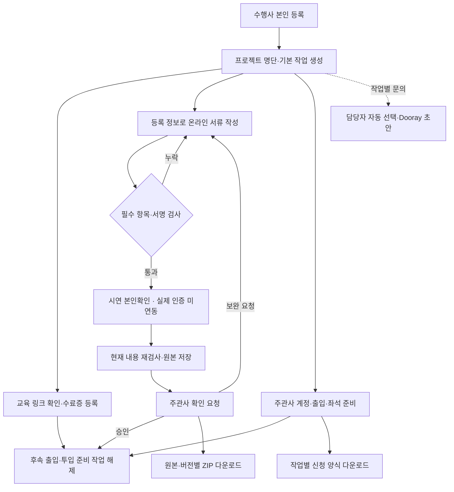

# 수행사 본인 등록 중심 워크플로우 고도화

작성일: 2026-11-14 · 대응 요청: 본인 등록부터 교육·서류·주관사 작업·문의까지 연결 · 디자인: 기존 흰 배경, 푸른색, 우리금융그룹 참고 캐릭터 유지

## 1. AS-IS와 적용한 흐름

| AS-IS                                 | 이번에 구현한 흐름                                                                       | 기대 효과 / 아직 검증하지 않은 효과                                   |
| ------------------------------------- | ---------------------------------------------------------------------------------------- | --------------------------------------------------------------------- |
| 담당자가 엑셀을 받아 인원 등록·취합   | 수행사 본인이 정보 등록 → 프로젝트 명단과 기본 작업 자동 생성                            | 입력·재취합 감소. 실무 절감 시간은 별도 측정 필요                     |
| 종이 출력·서명·스캔·파일 수집         | 등록 정보 자동 입력 → 온라인 작성 → 누락 검사 → 시연 본인확인 → 원본 생성·검토 요청      | 출력·스캔 단계를 줄이는 흐름 시연. 실제 본인인증·전자서명은 후속 연동 |
| 신청마다 같은 인원 정보를 양식에 복사 | 작업·프로젝트·대상 인원을 선택해 eGIS·Dooray·출입·좌석별 예시 XLSX 다운로드              | 복사·누락 가능성 감소. 실제 사내 서식을 확보하면 필드 매핑 교체       |
| 제출 파일이 개인 폴더에 분산          | 원본 보관함에서 검색·서류·상태·프로젝트 필터, 버전 조회와 선택 ZIP 다운로드              | 현재 브라우저에서 원본과 제출 현황을 함께 확인. 운영 서버 보관은 후속 |
| 반복 문의마다 담당자·맥락 재확인      | 작업별 담당자 매핑 → 문의자·프로젝트·작업·상태 자동 입력 → 앱 내 접수·Dooray 문의문 복사 | 실제 메시지 전송은 API 어댑터 연결 후 지원                            |

## 2. 수행사 흐름

1. 상단 **수행사 본인 등록**에서 이름·소속·프로젝트·연락처·이메일·역할·투입 예정 시작/종료일을 입력한다.
2. 등록 이메일 중복, 필수 항목, 날짜·전화번호 형식을 검사하고 고유 인원 ID를 생성한다. 이메일 중복 시 기존 인원 화면 이용을 안내한다.
3. 등록 직후 본인 화면으로 이동한다. 필수 교육 2개, 서류 2개, 주관사 준비 작업이 배정된다. 신규 본인 등록 인원의 교육은 계정 발급 대기와 병행할 수 있다.
4. **내 정보**에서 등록 내용과 배정된 작업을 확인한다. 정보 정정은 담당자 변경 요청으로 접수한다. 프로젝트 변경·실적/MM 산정은 이번에 자동화하지 않는다.
5. 교육은 외부 링크에서 수강한 뒤 수료증을 업로드한다. 외부 교육을 실제로 진행하거나 수료증을 발급하지 않는다.
6. 서류는 **서류 → 서류 열기**에서 온라인 작성한다. 기존 가상/업로드 제출본은 종전 검토 흐름을 보존한다. 완료·보완·작성 가능한 기존 서류에서는 **온라인으로 작성**으로 새 온라인 작성 흐름을 시작할 수 있다.

## 3. 온라인 서류와 작성 가이드

### 3.1 문서와 가이드가 함께 움직이는 화면

왼쪽에는 실제 입력 폼, 오른쪽에는 기존 파란 캐릭터와 작성 가이드를 둔다. 모바일은 같은 내용을 위아래로 배치한다. 가이드의 단계·누락 항목을 누르면 해당 부분으로 이동하며, 입력 중인 문서 구역을 강조한다.

- 01 등록 정보 확인: 이름·소속·프로젝트·이메일·투입 예정 기간을 자동 입력하고 연락처를 확인한다.
- 02 중요 조항: 보안 준수 / 개인정보 수집·이용 안내의 중요 내용을 표시하고 읽기·내용 확인 여부를 받는다.
- 03 서명·확인: 등록 성명과 같은 본인 입력 서명 및 시연 본인확인을 받는다.

가이드는 **규칙 기반 시연**이다. 실제 LLM을 호출하거나 문서를 이해·판독했다고 표시하지 않는다. 누락 차단은 AI 응답에 의존하지 않는 결정적 검사로 구현했다. 동의 여부는 자동 선택하지 않는다. 개인정보 동의서는 **동의하지 않음**도 명시적으로 제출할 수 있으며 담당자 별도 확인으로 전달한다.

### 3.2 제출 제한과 확인 기록

필수 읽기·내용 확인·서명·연락처·등록 정보 일치 검사를 통과해야 시연 확인번호를 요청할 수 있다. 화면에 표시하는 `135790`은 공개된 **시연 번호**이며 문자를 발송하지 않는다. 이름 입력이나 이 번호 확인을 실제 본인인증으로 취급하지 않는다.

시연 확인은 현재 인원 ID·등록 정보 버전·양식 버전·작성 내용에 연결한다. 내용을 바꾸면 확인을 다시 받아야 하며, 확인 후 10분이 지나면 재확인이 필요하다. 제출 직전에도 같은 검사를 수행한다.

제출 원본은 현재 **자체 포함 HTML 문서**다. 작성 내용, 본인 입력 서명, 시연 확인 방식·시점·식별자, 양식 버전, 제출 버전·시점을 포함한다. 다운로드한 HTML을 브라우저에서 열어 인쇄 / PDF로 저장할 수 있다. 정식 기관 양식, 인증된 전자서명 문서, 자동 생성 PDF라고 표현하지 않는다.

### 3.3 저장과 재제출

- 작성 중 내용은 localStorage에 임시 저장한다. 시연 확인 상태는 임시 저장에서 복구하지 않는다.
- 새 제출 원본은 IndexedDB에 저장한 뒤에만 작업 상태를 확인 요청으로 갱신한다. 저장 실패 시 제출 성공으로 처리하지 않는다.
- 원본 SHA-256, 인원·작업·제출 버전 식별자와 메타데이터를 연결한다. SHA-256은 내용 무결성 비교용이며 작성자의 실제 신원이나 법적 효력을 증명하지 않는다.
- 보완 요청 이후 재제출하거나 승인된 문서를 새 버전으로 작성해도 이전 원본은 덮어쓰지 않는다.
- 새로고침 후에도 같은 브라우저에서 실제 업로드한 수료증·서류 원본을 읽고 다운로드할 수 있다.
- 초기 시연 데이터는 가상 제출 메타데이터만 있어 원본 다운로드에서 제외하고 **초기 가상 자료 · 원본 없음**으로 표시한다.

## 4. 주관사 흐름

### 4.1 명단과 연결 작업

본인 등록 인원은 기존 명단에 이름과 고유 ID로 즉시 표시된다. 프로젝트 담당자는 자신의 인원만 관리하고, PMO는 전체를 관리한다. 각 인원에게 필요한 수행사 작업과 주관사 작업을 같은 준비 작업 화면에서 확인한다. 이전에 추가한 프로젝트별·개별 추가 작업 기능과 좌석 일괄 저장 방식은 유지한다.

### 4.2 작업별 신청 양식

**인원 명단 → 작업 양식** 또는 **준비 작업 → 작업 양식 다운로드**에서 프로젝트·작업·대상 인원을 선택한다. 프로젝트 담당자의 프로젝트는 고정한다. 내보내기 함수에서도 프로젝트·인원 범위를 검사한다.

| 예시 양식        | 주요 항목                                            |
| ---------------- | ---------------------------------------------------- |
| eGIS 계정 신청   | 성명·소속·프로젝트·역할·이메일·연락처·사용 예정 기간 |
| Dooray 계정 신청 | 표시명·회사·프로젝트·이메일·연락처·가입/종료 예정일  |
| 출입 신청        | 성명·소속·프로젝트·연락처·출입 예정 기간             |
| 좌석 배정        | 성명·프로젝트·연락처·사용 예정 기간·저장된 배정 좌석 |

실제 사내 양식은 제공되지 않아 예시 v1.0을 사용한다. 값이 없는 기존 시연 인원의 항목은 **미입력**으로 표시하고 양식 안내 시트에 확인 필요성을 적는다. 이 파일은 신청 데이터이며 외부 시스템에 계정·출입을 실제 신청한 결과가 아니다.

### 4.3 검토·보완·일괄 다운로드

**교육·서류 검토**에서 온라인 서류의 제출 내용·입력 서명·시연 확인 기록을 보고 승인/보완 요청한다. 필수 항목 검사 통과가 담당자 승인으로 이어지지는 않는다. 승인 후 기존 선행·후속 작업이 갱신된다.

상단 **제출 원본 보관함**은 인원/파일명 검색, 서류 종류·프로젝트·상태 필터, 이전 제출 버전 포함을 지원한다. 원본을 우선 표시한다. 최대 100개·200MB를 선택해 ZIP으로 다운로드하며, 원본 바이트와 `제출현황.json`을 함께 담는다. 파일은 프로젝트/인원/버전 기준으로 구분한다. 검토 상태는 내보내기 시점의 현재 작업 상태라고 명시한다.

ZIP 생성 시 프로젝트 권한, 저장된 파일의 인원·작업 식별자, 원본 무결성을 다시 확인한다. 원본이 없거나 검사에 실패하면 다운로드 성공으로 표시하지 않는다.

## 5. 작업별 담당자와 Dooray 연결 준비

**운영 기준 → 작업별 문의 담당자**에서 프로젝트 기본 담당자 또는 작업별 담당자를 설정한다. 작업별 설정이 기본 설정보다 우선한다. 각 담당자는 자신의 프로젝트만 설정하며, PMO는 프로젝트를 선택한다. Dooray 수신자 ID를 저장할 수 있으나 API 비밀키는 프런트엔드에 두지 않는다.

작업 문의 시 담당자·수신자 ID와 문의자·프로젝트·작업·현재 상태가 함께 담긴 초안을 보여준다. 앱 내 접수와 **Dooray 문의문 복사**를 지원한다. 실제 전송 어댑터가 없어 전송 상태는 `not_connected`이며 성공 응답이나 발송 완료를 만들지 않는다.

운영 연결에는 다음이 필요하다.

1. 사내 본인인증/전자서명 사업자 선정, 서버 콜백 검증과 문서 내용에 대한 인증 결과 연결.
2. 정식 서류 양식·수집 목적·보유기간 확정, 원본 저장 서버와 접근 제어, 제출 이력 보관.
3. 사내 Dooray 1:1 API 명세·인증 방식·전송 주체·프로젝트별 수신자 ID와 서버 어댑터.
4. 실제 LLM을 쓸 경우 승인된 모델과 근거 문서만으로 작성 지원을 제공하고, 제출 검사는 서버의 규칙 검사로 유지.

이 정보가 없는 현재 상태에서 실제 본인인증, 실제 AI 분석, 실제 외부 메시지 전송을 완료했다고 표현하지 않는다.

## 6. 추가 아이디어 — 이번에는 구현하지 않음

### 6.1 업무 효율을 위한 AI 적용 순서

| 우선순위 | 아이디어                   | 입력과 결과                                                            | 평가 방법                               |
| -------- | -------------------------- | ---------------------------------------------------------------------- | --------------------------------------- |
| 1        | 문서 작성·누락 안내        | 승인된 양식·등록 정보 → 현재 항목 설명·누락 이유·해당 위치 이동        | 첫 제출 반려율, 작성 소요시간           |
| 2        | 다음 조치와 지연 원인 요약 | 작업 의존관계·기한·담당자 → 막힌 원인과 담당자별 다음 조치             | PMO 현황 취합 시간, 누락 작업 수        |
| 3        | 서류 기간 변경 영향 분석   | 변경 전후 기간·양식 규칙 → 재확인/재제출 대상과 근거                   | 불필요 재수집 건수, 만료 서류 사용 건수 |
| 4        | 반복 문의 지식화           | 담당자가 승인한 답변·최신 업무 기준 → 근거/유효일이 있는 안내          | 반복 문의 비율, 담당자 응대 시간        |
| 5        | 월 마감 점검               | 승인된 실제 투입 이력·투입률 → 날짜 공백·중복·100% 초과·확인 필요 항목 | MM 정산 수정 건수, 마감 소요시간        |

AI가 인원 투입·철수일, 동의 여부, 서명, 문서 승인 또는 비용을 임의로 확정하지 않도록 한다. 자동화는 자료 정리·영향 탐색·설명에 우선 적용하고 담당자의 확인 지점을 남긴다. 과제 성과는 AI 사용 횟수보다 취합 시간·반려율·반복 문의 감소로 평가한다.

### 6.2 기간 변경과 문서 재수집

사람의 프로필 하나에 기간을 계속 덮어쓰기보다 **프로젝트 참여 건**을 별도 관리한다. 한 사람이 여러 프로젝트에 참여하거나 재투입되는 경우 각각의 참여 건에 예정/실제 기간, 역할, 투입률과 변경 이력을 둔다.

추천 흐름은 **기간 변경 요청 → 영향 미리보기 → 담당자 승인 → 참여 이력 갱신 → 해당 문서만 재확인·재제출 배정**이다. 원본 문서는 당시의 참여 기간을 유지한다.

| 변경                    | 권장 처리                                                                                                  |
| ----------------------- | ---------------------------------------------------------------------------------------------------------- |
| 투입 종료일 연장        | 양식의 기간 의존 여부와 기존 적용 범위를 비교. 출입·계정 사용 기간 연장 작업과 필요 서류만 재배정          |
| 프로젝트·소속·역할 변경 | 영향받는 서류·권한·담당자를 다시 확인. 모든 교육을 일괄 재수강시키지 않고 교육 인정 범위·유효기간으로 판단 |
| 실제 투입 시작 지연     | 실제 시작일 확인과 예정일 차이를 남기고, 서류에 기재된 기준일의 변경 필요성을 판정                         |
| 조기 철수               | 실제 종료일과 사유, 계정/출입 회수·좌석/장비 반납을 함께 확인                                              |

각 양식에 `기간 포함 여부`, `기간 변경 시 재확인/재제출 규칙`, `교육/서류 유효기간`, `적용 프로젝트`를 등록하면 AI는 영향과 이유를 설명하고 최종 판정은 규칙과 담당자가 수행할 수 있다. 기존에 유효한 무기한 서약서까지 반복해서 받는 방식은 피한다.

### 6.3 MM 관리의 기초 데이터

예정 기간, 실제 투입/철수일, 계약 기간을 구분한다. 실제 이력은 담당자가 승인하고 정정 이력을 남긴다. 프로젝트/역할/투입률이 바뀌면 기간 구간을 나누며, 겹치는 투입률의 합이 조직 기준을 넘는지 검사한다.

MM의 예시는 `해당 월 인정 투입일수 ÷ 해당 월 기준 근무일수 × 투입률`이다. 다만 계약에 따라 고정 20/22일, 달력 일수, 월 단위 등 기준이 다르므로 계산 기준을 먼저 확정해 설정해야 한다. 예정일 또는 좌석 배정일을 실제 투입 실적으로 간주하지 않는다. 휴일·휴가·입퇴실 데이터 연계는 별도 범위로 둔다.

월별 예정 MM / 실제 MM / 차이, 프로젝트별 투입 현황, 근거 참여 이력, 마감·재개방·정정 사유를 제공하면 후속 정산에 연결할 수 있다.

### 6.4 추가로 필요한 인력관리 기능

1. **철수 회수 체크리스트:** 계정·권한·출입·장비·좌석·자료 반납을 담당자별로 연결하고 종료 전 누락을 확인한다.
2. **유효기간과 재교육 알림:** 수료증·서약·출입 권한별 만료일과 재확인 기준을 관리한다.
3. **담당자 인수인계:** 담당자 변경 시 미처리 작업·문의·검토 요청을 대체 담당자에게 넘기고 이력을 남긴다.
4. **참여 이력·중복 등록 정리:** 동일 인물의 재투입·프로젝트 겸임을 지원하되 제출 문서와 연락처의 적용 범위를 분리한다.
5. **운영 대시보드:** 이번 주 투입/철수 예정, 기한 초과, 담당자별 검토 적체, 준비되지 않은 투입 건을 우선 표시한다.

## 7. 검증과 범위

단위 검증은 등록·중복·날짜, 자동 배정, 문서 누락·등록 정보 일치·서명·확인 만료, 원본 버전·HTML 이스케이프, 프로젝트 내보내기 권한, 문의 매핑, ZIP CRC/UTF-8 원본을 대상으로 한다. 브라우저 검증은 본인 등록부터 검토·ZIP·XLSX까지의 실제 흐름, 동의 거부, 재제출, 원본 복원, 모바일을 대상으로 한다. 기존 좌석·작업·교육·문의 흐름도 회귀 검증한다.

현재 결과는 **서버 없는 인터랙티브 프로토타입**이다. localStorage와 IndexedDB는 같은 기기·브라우저·출처에서 동작하며 서로 다른 PC 간 공유 원장은 아니다. 실제 운영 인증·서버 권한·사내 연동·서류의 법적 효력·현업 절감 효과는 검증 대상에 포함하지 않는다. 6장의 아이디어는 구현한 것으로 표시하지 않는다.
